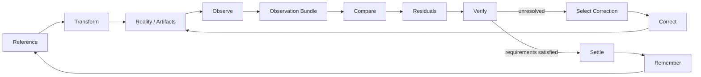
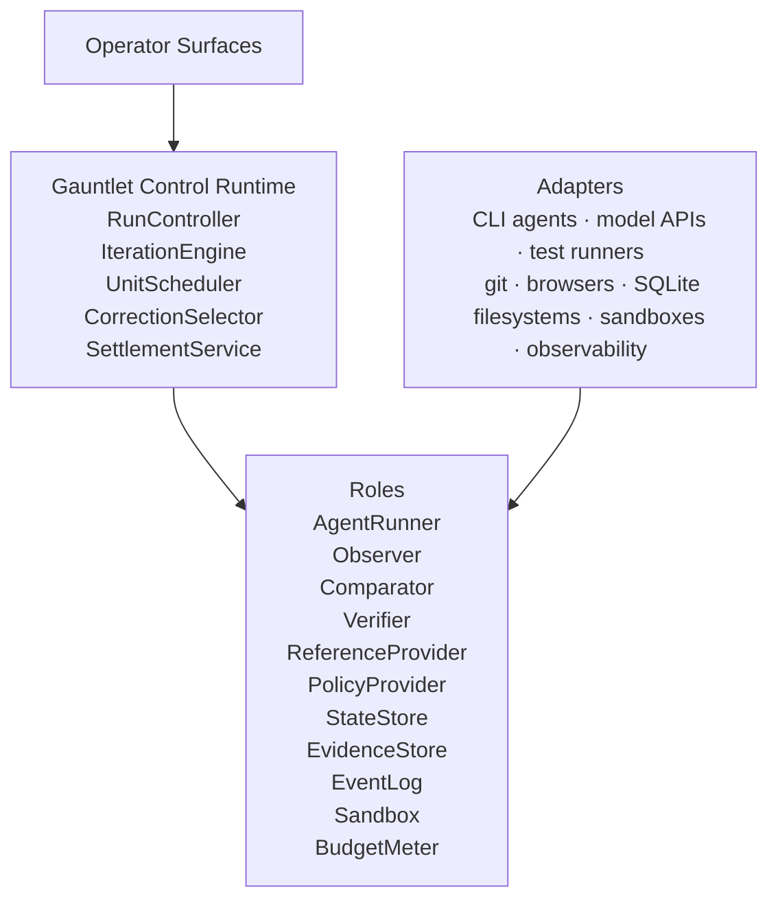

# Gauntlet

**A governed comparison-and-correction runtime for agentic work.**

> An agent saying "done" is not a control system.

---

## The problem

You ask an agent to build something. It edits files, runs commands, calls tools, and reports back: done.

You believe it. The terminal is clean. The summary reads well. Nothing in front of you says otherwise.

Then, later:

- The test it says passed never ran.
- The requirement it says it met got quietly rewritten mid-task, to match what got built instead of the other way around.
- The fix broke something three files away that nobody checked.
- You find out in production. Or in a client demo. Or three sprints later, when someone else touches the code and it falls apart.

None of that is a model problem. It's a structural one. The agent that did the work is also the only one certifying that it's correct. Nothing independent is checking whether "done" is true.

You can respond to that by reading every diff yourself and rerunning every test by hand. That scales to one project. Not to a team, and not to a business that runs on this working.

Or you can grant broad autonomy and hope. That works until the day it costs you something you can't get back: a security incident, a broken production system, a client who stops trusting your delivery.

Gauntlet is the third option: give agents real room to work, without giving any single agent enough authority to grade its own homework.

---

## What you get

- **The claim and the check are separated.** Something other than the builder decides whether the work actually happened.
- **The target can't move mid-run.** If the work doesn't meet the requirement, the requirement doesn't quietly get rewritten to match the work.
- **Not knowing stays "not knowing."** A missing test, a timeout, an unavailable tool: none of it gets rounded up to a pass.
- **Fixes stay small.** Gauntlet corrects the smallest thing that's actually broken, not the whole system, every time.
- **Nothing gets forgotten.** A crash or restart doesn't erase what was already proven.
- **"It worked once" doesn't become "it's reliable."** A pattern earns reuse only after it survives being tried again, under different conditions, with recovery from failure along the way.

---

## How it works

Every Gauntlet run moves through the same loop:

reference → transform → observe → compare → verify → correct → settle → remember

In plain terms:

1. Gauntlet figures out what "correct" actually means before anyone starts building. That's the **Reference**.
2. A builder, an agent, a script, a person, does the work.
3. An instrument, not the builder, observes what actually happened.
4. Gauntlet compares that observation against the Reference and flags every real difference.
5. A verifier checks each difference against hard evidence: a test result, a compiler error, a scan, a human signoff.
6. Whatever's still wrong gets the smallest fix that could plausibly close the gap.
7. The loop repeats until the work settles, or until it hits a limit and stops honestly instead of pretending.
8. What happened gets kept, so the next run doesn't start from zero.



Four distinctions do most of the work, and ordinary agent workflows tend to collapse all four:

- **Transform is not observe.** The builder changes the target. The builder doesn't get to decide what the change proves.
- **Observe is not compare.** Observation records what's actually true. Comparison is what's different from what was supposed to be true.
- **Compare is not verify.** A reviewer can spot something that looks wrong. Only a verifier, checking against real evidence, gets to say pass or fail.
- **Execute is not settle.** A command running successfully is a much weaker claim than "the required outcome happened, and here's the evidence."

---

## The Reference is the ruler, and it doesn't move

Every run works against one frozen Reference: what the finished thing is supposed to mean, what has to stay true, what can never happen, what evidence is required, what "done" actually looks like.

It breaks down into individually checkable claims, called Units:

```yaml
id: AK-014
claim: past dates are rejected
verify_by: test
blast_radius: local
authority: critic

evidence_required:
  kind: test_report
  locator: tests/leave/date_validation.rs::rejects_past_dates
  producer: instrument
```

A Unit isn't a task on a board. It's a falsifiable claim about the finished system. Gauntlet isn't trying to find out whether the agent did something. It's trying to find out whether the thing it built is actually true.

At the start of a run, the Reference gets resolved, normalized, digested, frozen, and isolated. It gets checked again before settlement. If it changed, the run doesn't quietly keep going.

That closes off the easiest form of self-deception in agentic work: the requirement gets hard, so the requirement quietly changes instead, so the new, easier requirement gets satisfied, so the system congratulates itself on a job well done. You've probably watched a team do this under deadline pressure. Gauntlet doesn't let an agent do it either.

Gauntlet can find out the Reference itself was wrong. That happens, and that's fine. What it can't do is rewrite the ruler mid-run and then claim the run passed. Changing the Reference is its own governed step, done on purpose, not a side effect of a hard afternoon.

---

## Builders don't review themselves

A builder's reasoning trail is useful for debugging. It's also the last thing you want a reviewer to see when deciding whether the builder's work should be trusted, because a good explanation is not the same thing as a correct outcome. You've had a code review get talked into an exception by a persuasive comment thread. Same failure mode. This is the machine version.

So the comparator doesn't get the builder's trajectory. It gets an explicit, constructed context: the frozen Reference, the observed state, instrument evidence, the comparison contract. It never sees the builder's reasoning, its identity, its self-grading, how many times it failed before this attempt, or its explanation for why this time is different.

That's not "please ignore the explanation" written into a prompt. It's an interface where the explanation never arrives in the first place.

---

## Critic and verifier are different jobs

| Role | Question it answers | What it produces |
|---|---|---|
| Comparator / Critic | What's materially different from the Reference? | A list of residuals |
| Verifier | Does this specific claim meet its declared evidence requirement? | PASS, FAIL, or INCONCLUSIVE |

A critic that sounds right doesn't get to settle a claim. Wherever hard evidence exists, the verifier uses it instead of judgment: a compiler, a test runner, a schema validator, a security scanner, a benchmark, a live probe, a human signoff.

Model judgment is good at finding problems. It doesn't get to authorize a pass.

---

## Missing evidence is not the same as passing evidence

Verification has three outcomes, deliberately not two:

| Outcome | Meaning |
|---|---|
| PASS | The claim was checked against its required evidence, and it held. |
| FAIL | The claim was checked, and it didn't hold. |
| INCONCLUSIVE | The evidence needed to check the claim isn't available yet. |

A missing test result isn't a pass. An unavailable tool isn't a pass. A timeout isn't a pass. A reviewer who can't decide isn't a pass. Something stays inconclusive until real evidence resolves it, or the run hits a bounded stopping point and says so honestly.

That distinction is easy to state and easy to lose the moment everything gets forced into true or false too early. Gauntlet doesn't force it.

---

## Authority and containment are two separate questions

**Authority:** is this work allowed to run at all?
**Containment:** how boxed in will it be if it does run?

Authority gets decided first. The sandbox gets built second. The builder starts third. A tight sandbox doesn't grant authority it wasn't given. Having authority doesn't remove the need for containment. Higher-impact or harder-to-undo work can require a human signoff, no matter how confident the agent sounds about itself.

---

## Agents are replaceable, on purpose

Gauntlet is built around roles, not products: AgentRunner, Observer, Comparator, Verifier, ReferenceProvider, and a handful of others. A specific coding agent, a CLI harness, a model API, a test runner, is an adapter behind one of those roles.



If swapping model vendors, or moving from a synchronous CLI agent to an async multi-agent harness, means rewriting your control loop, the boundary was drawn in the wrong place. Gauntlet doesn't assume a prompt-in, answer-out shape. It assumes invoke, then poll, then running, completed, failed, or timed out. That means a blocking CLI agent and a fire-and-forget async harness both fit the same runtime, without changing how either one is governed.

---

## Failure is a runtime state, not an exception

Agents fail. Tools fail. Networks drop. Tests hang. Reviewers return garbage. Workspaces get dirty. Budgets run out. Machines restart at the worst possible time. Gauntlet treats all of that as normal operation, not an edge case to patch around later.

Every run is bounded: wall time, model spend, tool calls, parallelism, iteration count, cost, workspace scope, authority. If a limit isn't configured, conservative defaults apply. Missing configuration never means unlimited execution.

A run ends as one of: **SETTLED, BLOCKED, BUDGET_EXHAUSTED, ESCALATED, ABORTED, INCONCLUSIVE.**

Failure, reported honestly, is a legitimate outcome. A manufactured "it worked" is not.

---

## State survives the crash

Gauntlet's state doesn't live in a chat transcript or an agent's working memory. Every real transition gets written to durable state, evidence, and an append-only event log.

That means a restart is never "remind me what we were doing." A resumed run can reconstruct the Reference in use, which Units already settled, which residuals are still open, prior invocations, evidence collected, budget spent, and work still in flight, from records, not from asking an agent to remember.

Re-doing already-settled work because the orchestrator forgot isn't an inconvenience. It's a defect.

---

## What running it looks like

```bash
cd my-project

gauntlet run "Implement account lockout after repeated failed logins"
```

Gauntlet discovers your configuration, checks what evidence already exists in the project, decides whether a sufficient Reference exists, forms one if it doesn't, freezes it, and only then dispatches bounded work: observe, compare, verify, correct, and either settle or stop honestly with an evidence-backed report.

If it doesn't know enough to build a trustworthy Reference, it says so instead of guessing to keep the demo moving. That state is called **formation**. Unknowns stay visible until someone resolves them.

The full operator surface:

```text
gauntlet doctor
gauntlet init

gauntlet reference form / freeze / show / digest / diff / verify

gauntlet run "<desired transformation>"

gauntlet status
gauntlet inspect
gauntlet verify
gauntlet resume <run_id>

gauntlet escalations
gauntlet roles
gauntlet skills

gauntlet improve
gauntlet export
```

The CLI is the reference surface. Dashboards, TUIs, and other views can sit on top of the same runtime. None of them are the control system.

---

## Corrections stay small

When something's wrong, the answer isn't "rewrite everything and try again." Gauntlet picks the next correction based on what actually failed, what evidence exists, what authority is available, what budget is left, what blast radius is acceptable, and what a new observation would actually resolve.

The target is the smallest correction that could plausibly fix the real problem. Not the ordinary agent-loop instinct of failed, bigger prompt, bigger rewrite, more agents, hope.

---

## Capability has to be earned, not assumed

None of the following make something a reliable capability: having access to the model, having access to the tool, a good explanation, a convincing imitation, one successful attempt, one passing test, one good review, one settled run.

Work that settles first becomes **developmental memory**: attempts, failures, payments, residuals, corrections, recoveries. Append-only, and intentionally messy.

It's promoted to the **capability ledger**, routes, skills, prompts, agent-selection policies, only after it survives repetition, variation, transfer to a new context, and recovery from failure, without the verification standard quietly getting weaker along the way.

A workflow that got faster because it stopped checking the hard things didn't get more capable. It got less trustworthy, and that will cost you later, exactly when you can least afford it.

---

## Gauntlet improves itself the same way it improves everything else

Gauntlet is meant to get better at its own process over time. It isn't allowed to do that by changing production behavior and then grading the change with rules it just wrote for itself.

A candidate revision goes through isolated evaluation, historical replay, held-out comparison, regression testing, and a check against anything it's not allowed to weaken, before it gets promoted. The optimizer proposes. It doesn't quietly become the active system.

That means a future version of Gauntlet can build and evaluate the next version of Gauntlet without swapping out the version currently running underneath you. Self-improvement, with a rollback button.

---

## What stays true no matter what

| Invariant |
|---|
| The builder never modifies the standard its own work is judged against |
| Observation is never just the builder's claim that it's done |
| The comparator and the verifier are different roles |
| The builder never reviews itself through leaked reasoning or trajectory context |
| A plausible answer can generate a candidate fix. It never grants a pass on its own |
| One successful run doesn't become capability |
| Missing evidence never becomes passing evidence |
| Authority decides whether execution is allowed to start |
| The sandbox decides how contained it is once it starts |
| Budgets stay bounded even when nothing was configured |
| State gets rebuilt from durable records, not from chat history |
| Control logic depends on roles, not on a specific vendor or product |
| The runtime never moves its own ruler and then claims the score improved |

Where it's possible to enforce these structurally, Gauntlet enforces them structurally. They aren't suggestions written into a prompt.

---

## What Gauntlet is not

- Not an LLM
- Not a model router with extra steps
- Not a set of personas
- Not a prompt pack
- Not a code-review bot
- Not a test runner
- Not a task tracker
- Not a dashboard
- Not one specific multi-agent graph or agent harness
- Not a license for unlimited recursive autonomy

Any of those things can participate inside a Gauntlet run. None of them is Gauntlet. Gauntlet is the protocol that decides how their work becomes something you can actually rely on.

---

## Where it sits in the GodSpeed stack

Gauntlet runs standalone. Inside the larger GodSpeed architecture, it's the execution environment: the step that takes an authorized piece of work and actually carries it out, then hands back a trustworthy account of what happened.

```text
GodSpeed-Agent decides what to work on next
        ↓
SWE_SEED defines what "done" provably means
        ↓
SEA-Forge authorizes the attempt
        ↓
Gauntlet executes it and observes reality
```

Inside that boundary, Gauntlet can use whatever mix of agents, sub-agents, tools, critics, and parallel search actually gets the job done well. It doesn't grant itself more authority than it was given just because it found a clever way to use it.

---

## The short version

Freeze the ruler. Let the agents work. Observe reality independently. Materialize the difference. Verify with evidence. Correct the smallest useful thing. Stop when the work actually settles, not when it sounds settled. Remember what happened. Promote only what survives being tried again. Never let the system grade itself into capability.

That's Gauntlet.