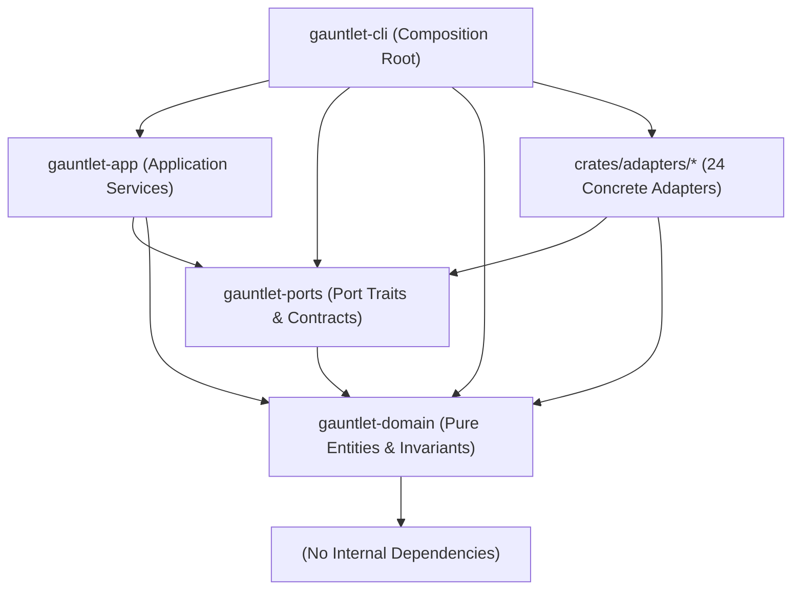
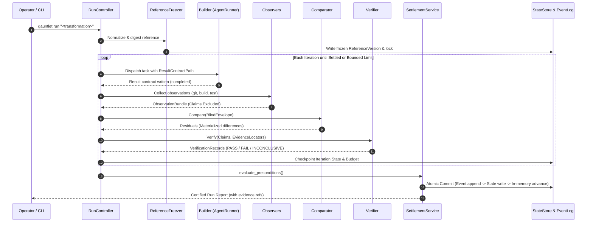
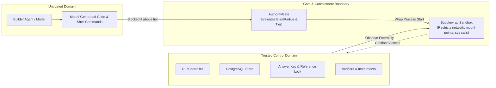

# System Architecture

Gauntlet is structured according to a strict **Ports and Adapters** (Hexagonal) architecture. The core domain and application control loops depend solely on semantic capability interfaces, never on specific external tools, models, databases, or operating system mechanisms.

---

## 1. Logical Architecture

The logical system is divided into four inward-pointing concentric layers:

```text
                  ┌────────────────────────────────────────────────────────┐
   Adapters       │   mock-runner · cli-runner · prime-runner · git-obs    │
  (Periphery)     │   pg-state     · fs-evidence · bwrap-sandbox · ...     │
                  └─────────────────────────┬──────────────────────────────┘
                                            │ implements
                  ┌─────────────────────────▼──────────────────────────────┐
     Ports        │   AgentRunner · Observer · Comparator · Verifier       │
  (Contracts)     │   StateStore · EvidenceStore · EventLog · Sandbox ...  │
                  └─────────────────────────┬──────────────────────────────┘
                                            │ used by
                  ┌─────────────────────────▼──────────────────────────────┐
   Application    │   RunController · IterationEngine · UnitScheduler      │
  (Orchestration) │   CorrectionSelector · SettlementService · Doctor      │
                  └─────────────────────────┬──────────────────────────────┘
                                            │ operates on
                  ┌─────────────────────────▼──────────────────────────────┐
     Domain       │   Reference · Unit · Run · Iteration · Observation     │
     (Core)       │   Comparison · Verification · Settlement · Budget      │
                  └────────────────────────────────────────────────────────┘
```

### Layer Responsibilities

1. **Domain Layer (`crates/gauntlet-domain`)**:
   - Contains pure business logic, value objects, aggregates, and state machines.
   - Enforces core constructor invariants (e.g., `irreversible` blast radius requires `human` authority; `Outcome` is strictly three-state).
   - Zero internal dependencies and zero framework dependencies.
2. **Ports Layer (`crates/gauntlet-ports`)**:
   - Declares the 17 abstract semantic capability traits (`AgentRunner`, `Observer`, `Comparator`, `Verifier`, `StateStore`, etc.).
   - Contains typed error enums and strict schema definitions (`role_result@v1`).
   - Houses the shared contract test suites (`crates/gauntlet-ports/src/contract/`) that every adapter must pass.
3. **Application Layer (`crates/gauntlet-app`)**:
   - Implements the Gauntlet control runtime: `RunController`, `IterationEngine`, `UnitScheduler`, `CorrectionSelector`, and `SettlementService`.
   - Handles reference freezing, comparison envelope allowlisting, diagnostic testing, and preflight doctor checks.
   - Consumes ports; never imports or references concrete adapters.
4. **Adapters Layer (`crates/adapters/*`)**:
   - Implements the ports using concrete technologies: PostgreSQL for state persistence, filesystem for content-addressed evidence, Bubblewrap for Linux sandboxing, and various runners (CLI, Prime-Agent, Mock).
   - Never referenced by domain or application crates.
5. **Composition Root (`crates/gauntlet-cli`)**:
   - The CLI binary and library that parses CLI arguments, resolves configuration, constructs the concrete adapters, injects them into the application layer, and launches execution.

---

## 2. Dependency Architecture

Dependency directions are architectural invariants enforced mechanically by `crates/gauntlet-arch-tests` (`just boundaries`):



### What to Notice in the Dependency Graph
- **Strict Inward Flow**: Dependencies flow downward and inward toward `gauntlet-domain`. Domain never points to ports, app, or adapters.
- **Adapters Depend on Contracts, Not Controllers**: Adapters implement `gauntlet-ports` traits and consume `gauntlet-domain` types. An adapter cannot call `gauntlet-app` or trigger another iteration.
- **Composition Root Isolation**: Only `gauntlet-cli` imports `adapters`. If a new database or agent model is added, zero lines of code in `gauntlet-domain`, `gauntlet-ports`, or `gauntlet-app` change.

---

## 3. Runtime Architecture & Topology

When `gauntlet run` or `gauntlet serve` executes, the runtime manages processes, isolated filesystems, durable storage, and optional interactive operator surfaces:

```mermaid
flowchart TB
    subgraph HostOS ["Host Environment (WSL2 / Linux)"]
        CLI_PROC["gauntlet-cli Process\n(RunController, IterationEngine, Schedulers)"]
        SURF_ADAPT["JsonOperatorSurface\n(HTTP/JSON Loopback API)"]
        
        subgraph FS_Storage ["Durable Local Storage"]
            POSTGRES[("PostgreSQL Database\n(Run state, iterations, invocations)")]
            EVENT_LOG[("Append-Only EventLog\n(events.jsonl, fsync on commit)")]
            EVIDENCE_DIR[("Immutable Evidence Store\n(/tmp/gauntlet/evidence/sha256/...)")]
            LOCK_FILE[(".gauntlet/reference.lock\n(Answer key SHA-256 hash)")]
        end

        subgraph Workspaces ["Builder Workspace Root (/tmp/gauntlet/workspaces)"]
            subgraph Sandbox_Env ["Bubblewrap / Process Sandbox (Tier: local / contained)"]
                BUILDER_PROC["Builder Process\n(Claude CLI / Prime-Agent / Mock)"]
                WORKTREE["Git Worktree / Filesystem Mirror\n(Source code modifications)"]
            end
        end

        subgraph OperatorWorkbench ["Operator Workbench (workbench/ - Bun + TypeScript + OpenTUI)"]
            TUI_PROC["Operator Workbench Process\n(ShellSession, WorkbenchModel)"]
            PROJ_CACHE[("SQLite Projection Cache\n(Generations & Cursors)")]
            GATEWAY["OperationGateway\n(Router-Not-Authority)"]
            
            TUI_PROC <--> PROJ_CACHE
            TUI_PROC <--> GATEWAY
        end

        CLI_PROC -->|Write / Query| POSTGRES
        CLI_PROC -->|Append Event| EVENT_LOG
        CLI_PROC -->|Store Artifacts| EVIDENCE_DIR
        CLI_PROC -->|Verify Digest| LOCK_FILE
        CLI_PROC -->|Spawn & Contain| Sandbox_Env
        CLI_PROC <--> SURF_ADAPT
        
        GATEWAY <==>|Loopback HTTP / JSON\n(Bearer Token Auth)| SURF_ADAPT
        
        OBS_PROBES["Instrument Probes\n(cargo check, cargo nextest, git diff)"] -->|Inspect Reality| WORKTREE
        OBS_PROBES -->|Write Facts| CLI_PROC
    end
```

### Key Architectural Invariants
- **Read-Only Ruler**: `.wayfinder/answer-key.md` and `.gauntlet/reference.lock` reside in the host project tree and are strictly read-only or outside the builder workspace. Builders can never write to their own grading rubric.
- **Workspace Isolation**: Builders execute in temporary git worktrees (`/tmp/gauntlet/workspaces/<run_id>/<iteration>/`) isolated from the host repository.
- **Evidence Immutability**: All observer output and verifier artifacts are saved content-addressed by SHA-256 in the evidence store. The `EvidenceStore` trait exposes no overwrite or delete method.
- **Operator Surface Decoupling**: The operator workbench is a sibling client (`workbench/`) communicating via loopback HTTP/JSON (`JsonOperatorSurface`). It holds zero canonical truth and acts strictly as a projection and command router. If the TUI disconnects or terminates, running engine jobs proceed unaffected.

---

## 4. Data Architecture & State Ownership

State in Gauntlet moves through explicit, immutable aggregates across defined persistence boundaries:



### Data Boundaries
1. **Observation Bundle**:
   - Contains facets: `versioning`, `filesystem`, `build`, `test`, and `command`.
   - Each facet carries instrument identity, exit code, execution duration, and content-addressed evidence reference.
   - Any builder text is isolated in `claims_facet` marked `excluded_from_verification: true`.
2. **Comparison Envelope**:
   - Built by `EnvelopeBuilder` via an allowlist of fields.
   - Contains the reference projection and instrument observations.
   - Strips builder reasoning, trajectory, identity, and attempt history.
3. **Verification Record**:
   - Explicitly records `unit_id`, `verify_by`, `locator`, `producer`, `outcome`, and `evidence_ref`.
   - Never accepts model assertions when `producer: instrument` is declared.

---

## 5. Trust and Security Boundaries

Gauntlet enforces strict security fences between autonomous models and the host environment:



### Governance Rules
1. **Authority Precedes Containment**: The `AuthorityGate` verifies whether a unit's blast radius is permissible for the executing role before any process is spawned.
2. **Sandbox Wraps Process Start**: Unlike naive systems that audit commands after execution, Gauntlet initializes the sandbox before the first token of the builder executes.
3. **Irreversible Blast Radius**: Units with `blast_radius: irreversible` (such as production deployments or credential changes) require `authority: human`. They are never auto-dispatched and instead yield an escalation ticket in `.gauntlet/escalations/`.
4. **No Unsandboxed Fallback**: If a sandbox backend fails to initialize, execution does not fall back to an uncontained run; it fails closed and escalates to the operator.

---

## 6. Operator Workbench Subsystem (`workbench/`)

The terminal-native operator workbench is a sibling client subsystem designed to provide human operators with real-time operational visibility and control without violating Gauntlet's governance invariants.

### Architectural Separation
- **Sibling Boundary**: `workbench/` is located at the workspace root alongside `crates/`. It is completely decoupled from the Cargo build graph and compiler scanner tools (`crates/gauntlet-arch-tests`).
- **Loopback Surface Protocol**: Communication between `workbench/` and Gauntlet core uses HTTP/JSON loopback streaming (`gauntlet serve` / `JsonOperatorSurface`). All operator commands require explicit bearer token and actor identity bindings.
- **Router-Not-Authority**: `OperationGateway` routes commands and generates deterministic idempotency keys. It never authorizes mutations locally. Before dispatching any operator action, it re-queries Gauntlet core for a fresh canonical observation and fails closed if the target surface is unobservable or if requirements have shifted.
- **Reconstructible Read Models**: The workbench maintains a private SQLite database (`SqliteProjectionStore`) with cursor-tracked event streams. Presentation views are pure projections over immutable snapshots (`FullWorkbenchSnapshot`) published by `WorkbenchModel`.

For full subsystem architecture, see [`subsystems/tui.md`](subsystems/tui.md). For the normative visual and presentation design contract, see [`DESIGN.md`](../DESIGN.md).

---

## Source Trail

- [`crates/gauntlet-domain/src/lib.rs`](../crates/gauntlet-domain/src/lib.rs) — Domain aggregates, value objects, and invariants.
- [`crates/gauntlet-ports/src/lib.rs`](../crates/gauntlet-ports/src/lib.rs) — The 17 capability port traits and contract test suites.
- [`crates/gauntlet-app/src/control/controller.rs`](../crates/gauntlet-app/src/control/controller.rs) — `RunController` orchestration loop.
- [`crates/gauntlet-app/src/settle/mod.rs`](../crates/gauntlet-app/src/settle/mod.rs) — `SettlementService` 5-step precondition validation.
- [`crates/gauntlet-app/src/compare/envelope.rs`](../crates/gauntlet-app/src/compare/envelope.rs) — `EnvelopeBuilder` structural context blindness.
- [`crates/gauntlet-app/src/govern/gate.rs`](../crates/gauntlet-app/src/govern/gate.rs) — `AuthorityGate` pre-execution containment check.
- [`crates/gauntlet-cli/src/compose.rs`](../crates/gauntlet-cli/src/compose.rs) — CLI adapter wiring and composition root.
- [`crates/gauntlet-arch-tests/src/deps.rs`](../crates/gauntlet-arch-tests/src/deps.rs) — Mechanical compile-time enforcement of layer directions.
- [`crates/adapters/gauntlet-adapter-surface-json/src/lib.rs`](../crates/adapters/gauntlet-adapter-surface-json/src/lib.rs) — `JsonOperatorSurface` loopback HTTP/JSON server.
- [`workbench/src/main.ts`](../workbench/src/main.ts) — Operator workbench host loop and terminal lifecycle.
- [`workbench/src/operation-gateway.ts`](../workbench/src/operation-gateway.ts) — Isomorphic command gateway and router-not-authority engine.
- [`workbench/src/workbench-model.ts`](../workbench/src/workbench-model.ts) — Projection accumulator and immutable snapshot fan-out.
- [`DESIGN.md`](../DESIGN.md) — Canonical TUI design system and presentation contract.

