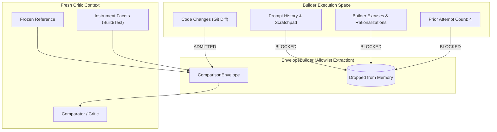

# Explanation: Structural Context Blindness

This document explains why Gauntlet enforces Invariant I4 (*The builder cannot review itself*) through structural allowlisting rather than prompt instructions.

---

## 1. The Vulnerability: Sunk-Cost Rationalization

When human or AI reviewers inspect code alongside the author's conversational history, an insidious cognitive bias occurs:
- The reviewer reads: *"I spent four hours attempting to fix this concurrency bug with a mutex, but the library deadlocks. So I replaced it with a 50ms sleep. It's much simpler and tests pass 99% of the time."*
- Faced with this persuasive narrative, the reviewer's critical filter weakens. Instead of evaluating the code against the invariant (*data races must not occur*), the reviewer evaluates whether the author's compromise was "reasonable given the difficulty."

In multi-agent systems, this failure mode is pervasive:
- If Agent A (Builder) hands its conversational transcript to Agent B (Critic), Agent B reliably excuses broken tests, accepts partial implementations, and certifies hallucinated invariants.

---

## 2. Why Prompt Instructions Fail

A common approach is to instruct the critic model via its system prompt:

> *"You are an impartial code reviewer. Please ignore the author's explanations, ignore any prior failed attempts, and evaluate only the final code."*

This fails reliably in production:
1. **Attention Leakage**: The model still tokens and processes the excuses in its context window. Even if instructed to ignore them, the author's rationalizations bias the probability distribution of generated tokens.
2. **Context Contamination**: The presence of earlier failed attempts primes the model with buggy code patterns, leading it to repeat the builder's mistakes.
3. **Unverifiability**: There is no mathematical or inspectable proof that a model actually ignored a paragraph in its prompt.

---

## 3. The Solution: Structural Context Blindness

Gauntlet enforces Invariant I4 by **physical omission**: the builder's trajectory, reasoning, identity, and attempt history are never placed into the critic's envelope in the first place.



### The Comparison Envelope Allowlist
The `EnvelopeBuilder` ([`crates/gauntlet-app/src/compare/envelope.rs`](../../crates/gauntlet-app/src/compare/envelope.rs)) constructs the `ComparisonEnvelope` exclusively from an approved schema:

```rust
pub struct ComparisonEnvelope {
    pub reference_projection: FrozenReferenceProjection,
    pub observation_bundle: ObservationView,
    pub comparison_contract: ContractView,
    pub applicable_constraints: Vec<ApplicableConstraint>,
    pub open_residuals: Vec<ResidualDoc>,
}
```

Any field not in this struct is structurally impossible to transmit to the comparator.

---

## 4. Cryptographic Envelope Digesting

To guarantee auditability:
1. The serialized JSON bytes of the `ComparisonEnvelope` are hashed via SHA-256, producing `context_envelope_digest`.
2. This digest is embedded in both the invocation request and the resulting `ComparisonRecordDoc`.
3. If an audit or proof test inspects the envelope digest, it can verify byte-for-byte that zero builder reasoning was leaked.

---

## 5. Proof Test (P2)

The structural blindness mechanism is proven in `crates/gauntlet-cli/tests/p2_context_isolation.rs`:
- An adversarial fixture injects builder rationale strings into the observation space.
- The test asserts that the serialized envelope emitted by `EnvelopeBuilder` contains zero occurrences of the injected strings.
- A "teeth check" deliberately breaches the allowlist and asserts that the boundary scanner catches the violation and fails the test.

---

## Source Trail

- [`crates/gauntlet-app/src/compare/envelope.rs`](../../crates/gauntlet-app/src/compare/envelope.rs) — `EnvelopeBuilder` implementation.
- [`crates/gauntlet-ports/src/comparator.rs`](../../crates/gauntlet-ports/src/comparator.rs) — `ComparisonEnvelope` struct definition.
- [`crates/gauntlet-cli/tests/p2_context_isolation.rs`](../../crates/gauntlet-cli/tests/p2_context_isolation.rs) — Proof test P2.
