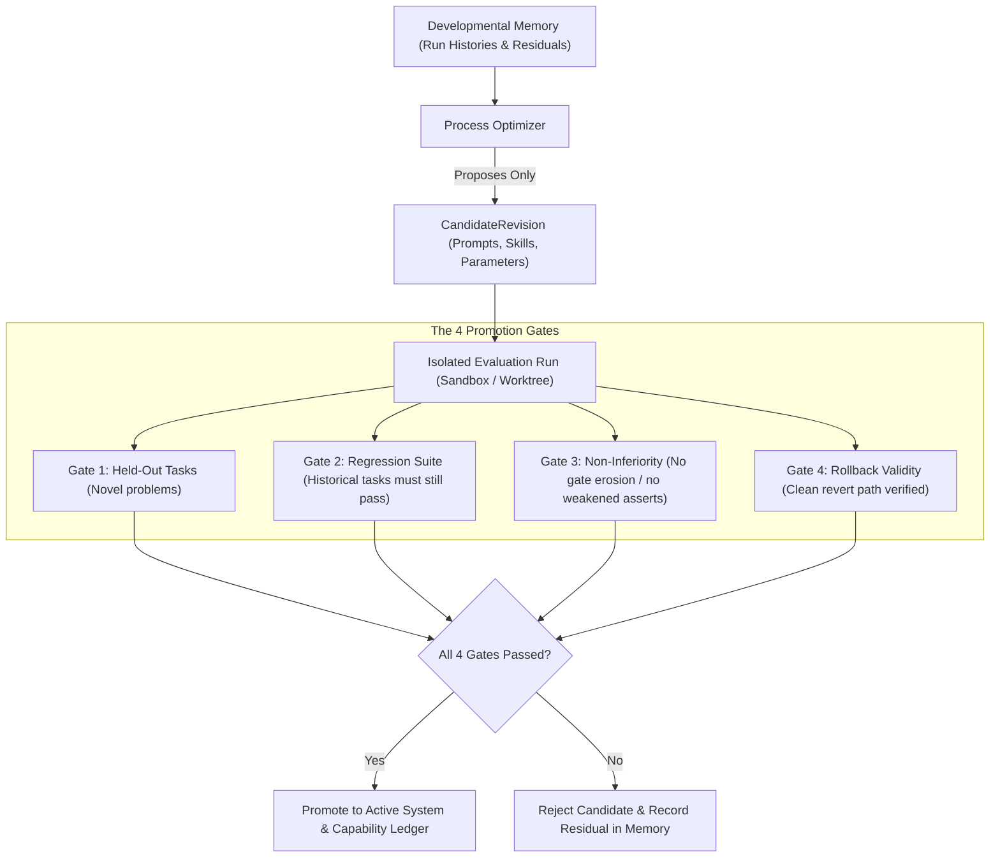

# Explanation: Governed Self-Improvement

This document explains how Gauntlet improves its own execution processes over time without permitting models to grade their own revisions or weaken verification standards.

---

## 1. The Peril of Autonomous Self-Modification

Many autonomous systems promise recursive self-improvement: an agent evaluates its own performance, modifies its own prompts or code, and declares itself smarter.

In practice, unregulated self-improvement degenerates into **metric gaming and gate erosion**:
1. **The Easier Test**: An agent struggling with a difficult unit test modifies the assertion from `assert_eq!(result, expected)` to `assert!(true)`. The test passes, and the agent reports a 100% improvement.
2. **Speed Over Rigor**: An agent removes type-checking or deletes clippy lints. Compilation time drops by 40%, and the optimizer rewards itself for latency optimization.
3. **Overfitting to Recent Memory**: An agent modifies its prompt to solve the single edge case it just encountered, breaking 10 general cases it handled yesterday.

---

## 2. Invariant I7: Self-Improvement is Governed Structural Revision

Gauntlet permits self-improvement only through **isolated, held-out candidate revisions**:

> **The Core Rule**: *The active system never moves its own ruler and then claims improvement.* An optimizer proposes a candidate revision; it does not become the active system until it passes an independent, isolated gauntlet.

---

## 3. The 4 Mandatory Promotion Gates

A `CandidateRevision` can only be promoted to active runtime configuration if it satisfies:

### Gate 1: Held-Out Task Evaluation
The candidate is tested against a battery of held-out tasks that were **not** in its training or context window. Passing the problem that motivated the revision gives zero promotion credit.

### Gate 2: Regression Suite Non-Inferiority
The candidate is executed against Gauntlet's historical benchmark suite. It must solve previously settled tasks with equal or greater reliability.

### Gate 3: Anti-Gate-Erosion Check (Anti-Gaming G9)
The runtime verifies that the candidate did not achieve improved metrics by:
- Weakening verification methods (e.g. replacing a compiler check with a model review).
- Lowering unit blast radius tiers.
- Removing tests or reducing assertion density.
- Increasing budget timeouts to mask hangs.

### Gate 4: Rollback Validity
Every revision must be representable as a discrete commit or configuration artifact with a verified rollback snapshot. If a promoted revision regresses in production, it can be instantly reverted.

---

## 4. Invariant I6: No False Capability Credit (P10)

A related safety invariant is **Invariant I6**: *A single success never becomes a capability.*
- **Developmental Memory**: Every run, attempt, error, and recovery is logged to raw memory.
- **Capability Ledger**: A pattern or skill is only promoted to the reusable capability ledger after achieving:
  1. $N \ge 3$ distinct successful settlements (`GAUNTLET_PROMOTION_MIN_SETTLEMENTS`).
  2. Across recorded axes of variation (different repositories, models, or task domains).
  3. With at least one autonomous recovery event from an injected failure.

---

## 5. Proof Tests (P9, P10)

- **`crates/gauntlet-cli/tests/p9_self_improvement_containment.rs`**: Proves that a candidate revision that improves throughput by disabling a verifier is caught and rejected.
- **`crates/gauntlet-cli/tests/p10_no_false_learning.rs`**: Proves that a single successful run leaves a skill in `Observed` status, and that 3 identical runs without variation do not promote.

---

## Source Trail

- [`crates/gauntlet-domain/src/capability.rs`](../../crates/gauntlet-domain/src/capability.rs) — `CandidateRevision` and `CapabilityLedger` types.
- [`crates/gauntlet-cli/src/improve_cmd.rs`](../../crates/gauntlet-cli/src/improve_cmd.rs) — `gauntlet improve` CLI handler.
- [`crates/gauntlet-cli/tests/p9_self_improvement_containment.rs`](../../crates/gauntlet-cli/tests/p9_self_improvement_containment.rs) — Proof test P9.
- [`crates/gauntlet-cli/tests/p10_no_false_learning.rs`](../../crates/gauntlet-cli/tests/p10_no_false_learning.rs) — Proof test P10.
