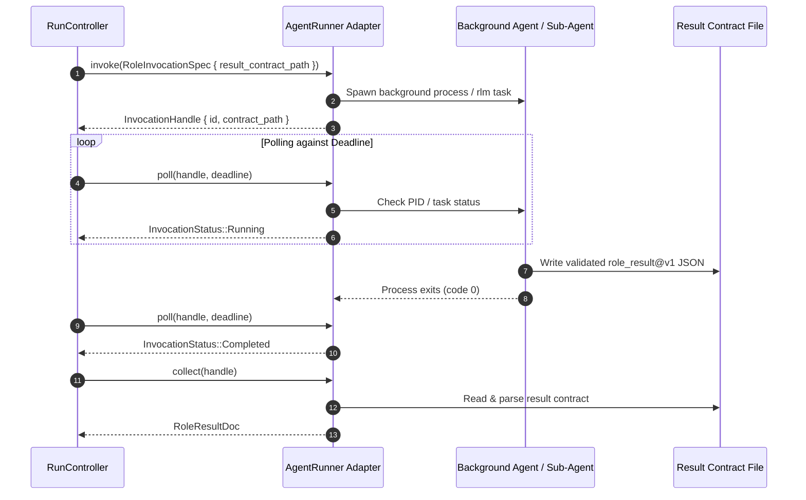

# Explanation: Why the Agent Runner is Admission-Based

This document details the architectural rationale behind Gauntlet's admission-based `AgentRunner` port interface, correcting structural Defect D1 from the early specification.

---

## 1. The Core Problem: The Blocking Call Fallacy

In early drafts of the runtime (v1), the interface for invoking an agent was modeled as a simple, synchronous function call:

```rust
// The naive, flawed v1 interface (Defect D1)
pub trait BuilderPort {
    fn run_turn(&self, workspace: &Path, prompt: &str) -> Result<TurnResult, BuilderError>;
}
```

This interface assumed that an agent is a synchronous request-response procedure: pass a prompt in, block execution, and receive an answer back.

### Why This Fails in Real Agent Harnesses
When integrating with modern recursive agent harnesses (such as Prime-Agent), this abstraction breaks completely:
1. **Immediate Task Admission**: In Prime-Agent, `rlm(...)` returns an admission handle (`rlm_child_id`, `session_dir`, `model`) **immediately after task admission**. It *never* waits for or returns the child's answer directly.
2. **Out-of-Band Delivery**: Child sub-agents execute in their own background processes or sandboxes, communicating via mailbox messages and writing completion artifacts to designated filesystem paths.
3. **Deadlock & Busy-Waiting**: A blocking `run_turn()` interface forced the runtime to either busy-wait in an infinite sleep loop or hang indefinitely on an interface that would never resolve synchronously.

---

## 2. The Architectural Correction (Defect D1 Corrected)

Gauntlet v2 re-architects `AgentRunner` around an **admission-based, polling, and out-of-band result-contract pattern**:

```rust
// The normative v2 interface (spec §6.1)
pub trait AgentRunner: Send + Sync {
    /// Admits a role invocation, binds permissions and contract paths,
    /// and returns an InvocationHandle immediately.
    fn invoke(&self, spec: &RoleInvocationSpec) -> Result<InvocationHandle, AgentError>;

    /// Non-blocking probe of invocation status.
    fn poll(&self, handle: &InvocationHandle, deadline: Deadline) -> Result<InvocationStatus, AgentError>;

    /// Collects and deserializes the role_result@v1 payload from disk.
    fn collect(&self, handle: &InvocationHandle) -> Result<RoleResultDoc, AgentError>;

    /// Idempotent cancellation.
    fn cancel(&self, handle: &InvocationHandle, reason: CancelReason) -> Result<(), AgentError>;
}
```

---

## 3. The Result-Contract Primitive

How does Gauntlet know when an asynchronous agent has finished?
Through the **Result Contract**:

1. **Contract Declaration**: When `RunController` prepares an invocation, it designates an absolute file path for the result document:
   ```text
   /tmp/gauntlet/workspaces/<run_id>/contract/result-<invocation_id>.json
   ```
2. **Schema Enforcement**: The child agent is instructed to write its completion summary to that path under the strictly-validated `role_result@v1` JSON schema.
3. **Completion Polling**:
   - `poll()` checks if the handle process is still running.
   - If the process exits, `collect()` verifies that a schema-valid `role_result@v1` file exists at the declared path.
   - If the process exits with status 0 but wrote no result document, the outcome is `InvocationStatus::Failed{missing_result}`, **never an assumed pass**.
   - If the process hangs, the `Deadline` triggers, and `cancel()` terminates the process cleanly.



---

## 4. Unifying Blocking CLIs and Async Harnesses

This pattern unifies both execution styles without compromise:
- **Asynchronous Harnesses (Prime-Agent)**: The adapter maps naturally to background sub-agents and mailbox handles.
- **Blocking CLI Agents (Claude CLI, Aider)**: The adapter spawns the process in a background thread; `invoke()` returns immediately; `poll()` calls `try_wait()`; and `collect()` parses the contract file written before exit.

Neither harness requires the core application runtime to rewrite its control loop.

---

## Source Trail

- [`crates/gauntlet-ports/src/agent_runner.rs`](../../crates/gauntlet-ports/src/agent_runner.rs) — `AgentRunner` trait, `InvocationHandle`, and `InvocationStatus`.
- [`crates/gauntlet-ports/src/role_result.rs`](../../crates/gauntlet-ports/src/role_result.rs) — `role_result@v1` schema and parser.
- [`crates/adapters/gauntlet-adapter-agent-prime/src/runner.rs`](../../crates/adapters/gauntlet-adapter-agent-prime/src/runner.rs) — Recursive harness implementation.
- [`crates/adapters/gauntlet-adapter-agent-cli/src/runner.rs`](../../crates/adapters/gauntlet-adapter-agent-cli/src/runner.rs) — Process-backed CLI runner implementation.
- [`crates/gauntlet-cli/tests/p8_adapter_substitution.rs`](../../crates/gauntlet-cli/tests/p8_adapter_substitution.rs) — Proof test P8 demonstrating runner substitutability.
