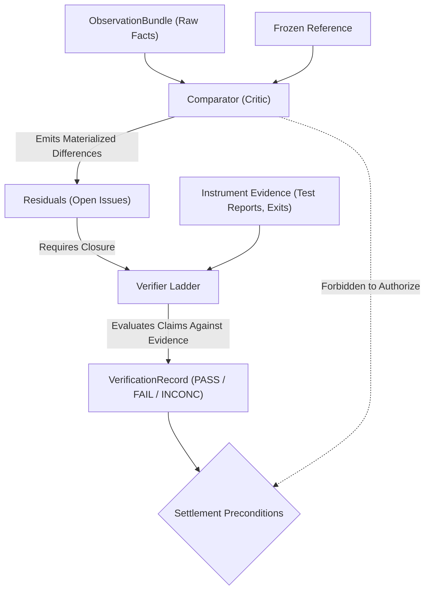

# Explanation: Why Critic and Verifier are Separate Roles

This document explains the architectural rationale behind separating the **Comparator (Critic)** from the **Verifier**, correcting structural Defect D3 from the early Gauntlet specification.

---

## 1. The Core Problem: The Persuasive Reviewer Fallacy

In early drafts of the Gauntlet architecture (v1), code comparison and verification were collapsed into a single "Review/Verification" phase. A language model acting as a reviewer looked at the code diff and issued a verdict: `PASS` or `FAIL`. If the reviewer emitted `PASS`, the Unit was closed as settled.

This collapsed design failed in testing due to the **Persuasive Reviewer Fallacy**:
1. **Plausibility $\neq$ Correctness**: A model can produce a beautifully articulated explanation of why code works, complete with accurate citations of software principles, while the code contains a fatal off-by-one bug or fails to compile.
2. **Reviewers Can Be Talked Into Exceptions**: If a model reviewer is exposed to the complexity of the task, it frequently rationalizes edge cases: *"The test for past dates failed, but the author implemented a reasonable fallback so this satisfies the spirit of the requirement."*
3. **Closing Units Without Reality**: A model's verbal agreement closed a checkable claim without any compiler, test runner, linter, or security probe having verified that reality matched the prose.

---

## 2. The Architectural Correction (Defect D3 Corrected)

Gauntlet v2 explicitly separates the two roles across ports, domain types, and data paths:

| Role | Port Trait | Output Record | Primary Question Answered | Source of Authority |
|---|---|---|---|---|
| **Comparator (Critic)** | `Comparator` | `ResidualSet` | *"What is materially different from the Reference?"* | Model judgment, heuristic diffs. |
| **Verifier** | `Verifier` | `VerificationRecord` (`PASS/FAIL/INCONC`) | *"Does this specific claim meet its declared evidence requirement?"* | Objective instruments (compilers, test runners, checksums). |



---

## 3. Structural Enforcement: The settlement Boundary

The separation is not merely a prompting convention; it is enforced structurally in `SettlementService`:

```rust
// In crates/gauntlet-app/src/settle/mod.rs
impl SettlementService {
    pub fn evaluate_preconditions(
        &self,
        unit: &Unit,
        residuals: &[Residual],
        verifications: &[VerificationRecord],
    ) -> Result<(), SettlementPreconditionError> {
        // 1. Check if any residuals remain open for this unit
        if residuals.iter().any(|r| r.unit_id == unit.id && !r.is_resolved()) {
            return Err(SettlementPreconditionError::OpenResidualsRemain);
        }

        // 2. A critic's opinion CANNOT settle a unit.
        // It MUST have a valid VerificationRecord with Outcome::PASS
        let pass_record = verifications.iter().find(|v| {
            v.unit_id == unit.id && v.outcome == Outcome::Pass
        }).ok_or(SettlementPreconditionError::MissingPassingVerification)?;

        // 3. The verification record MUST point to an instrument-produced evidence artifact
        self.verify_evidence_binding(pass_record)?;

        Ok(())
    }
}
```

If a critic reports "0 residuals, looks great!" but the test suite was never run, the Unit remains **unsettled** with `Outcome::INCONCLUSIVE`.

---

## 4. When Model Judgment is Permitted

Is model judgment ever allowed in verification?
Yes, but strictly under two constraints:
1. **Explicit Declaration**: The Unit's `verify_by` field must explicitly declare a subjective quality method (e.g. `VerifyBy::SemanticEvaluation`).
2. **Quality Dimension vs Unit**: In Gauntlet, claims that cannot be settled by a deterministic instrument are modeled as **Quality Dimensions** rather than blocking Units. Quality dimensions inform weighting, but can never override a failed invariant or an unrun test (Invariant I5: *Similarity never authorizes*).

---

## 5. Consequences and Trade-Offs

- **Increased Orchestration Cost**: The runtime must coordinate separate observation gathering, comparator execution, and verifier passes rather than doing everything in one prompt.
- **Immunity to Sycophancy**: A model cannot be flattered or persuaded into marking a test as passing. If the test did not exit 0, the task cannot settle.
- **Clear Diagnostic Division**: When an iteration fails, the system immediately knows whether the failure was a conceptual mismatch (flagged by the critic) or a hard broken invariant (flagged by the verifier).

---

## Source Trail

- [`crates/gauntlet-ports/src/comparator.rs`](../../crates/gauntlet-ports/src/comparator.rs) — `Comparator` port definition.
- [`crates/gauntlet-ports/src/verifier.rs`](../../crates/gauntlet-ports/src/verifier.rs) — `Verifier` port definition.
- [`crates/gauntlet-app/src/settle/mod.rs`](../../crates/gauntlet-app/src/settle/mod.rs) — Settlement precondition validation.
- [`crates/gauntlet-cli/tests/p11_critic_is_not_verifier.rs`](../../crates/gauntlet-cli/tests/p11_critic_is_not_verifier.rs) — Proof test P11 asserting that a critic cannot settle a Unit.
