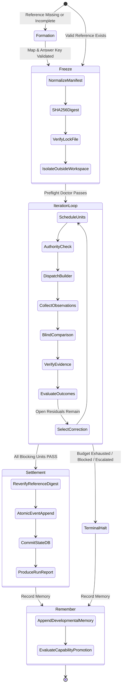

# System Mental Model

This guide explains how to think about Gauntlet without getting bogged down in low-level code details.

---

## 1. The Core Metaphor: The Cleanroom Inspection Line

Imagine an industrial manufacturing facility that produces high-precision aerospace components:

1. **The Blueprint (Reference)**: Before any metal is cut, engineers draft and sign an immutable blueprint with strict physical tolerances. This blueprint is locked in a vault and cannot be altered by machinists on the shop floor.
2. **The Machine Operator (Builder)**: A machinist cuts and mills the part in an isolated cleanroom work cell. The machinist may use any cutting technique, but has no access to the vault.
3. **The Laser Scanner (Observer)**: When the machinist finishes, physical calipers, laser scanners, and pressure sensors inspect the physical part. The machinist's verbal assurance ("I cut it perfectly") is ignored.
4. **The Blind Inspector (Comparator)**: An independent inspector compares the laser scan measurements directly against the vault's blueprint. The inspector does not know which machinist made the part, what tools were used, or how many prior attempts were discarded. The inspector marks any deviation as a *residual*.
5. **The Quality Lab (Verifier)**: A specialized metallurgical lab tests the residuals against strict physical tolerances. If a measurement passed, it is marked `PASS`. If it failed, it is `FAIL`. If a sensor was unplugged, it is `INCONCLUSIVE` (never assumed to have passed).
6. **Targeted Calibration (Correction)**: If a dimension is off by 0.2mm, only the calibration offset for that specific axis is adjusted. The entire machine is not demolished and rebuilt.
7. **The Certified Bill of Lading (Settlement)**: Only when all required tolerances hold with certified lab reports is the part stamped with a permanent serial number and logged into an unalterable ledger.

In software, autonomous coding agents often combine the machinist, inspector, quality lab, and shipping manager into a single entity. Gauntlet untangles these roles into separate, governed processes.

---

## 2. Responsibilities and Role Boundaries

Role boundaries in Gauntlet are architectural invariants:

| Role | Permitted Actions | Strictly Forbidden Actions |
|---|---|---|
| **Orchestrator** | Discovers reference, decomposes units, builds envelopes, verifies evidence, commits settlements, manages recovery. | Never writes implementation code while delegation is available. Never lowers unit tiers. |
| **Builder** | Modifies code in an isolated workspace/worktree, runs local builds, produces a result contract file. | Never modifies the Reference or Answer Key. Cannot grade its own work. Never decides settlement. |
| **Observer** | Gathers raw facts from the workspace (compilation exits, test output, file diffs, git trees). | Never interprets intent. Never decides pass or fail. |
| **Comparator (Critic)** | Evaluates an Observation Bundle against the Reference in a fresh context. Emits residuals. | Never sees builder trajectory or history. Never authorizes settlement. Cannot close a Unit. |
| **Verifier** | Evaluates a specific Unit claim against concrete instrument evidence. Yields `PASS`, `FAIL`, or `INCONCLUSIVE`. | Never relies on model opinion when instrument evidence is required. Cannot guess. |
| **Process Optimizer** | Proposes `CandidateRevision`s for prompts, skills, or parameters based on developmental memory. | Never modifies the active runtime. Proposals must pass held-out evaluation before promotion. |

---

## 3. The Four Great Separations

The power of Gauntlet comes from four distinctions that ordinary agent harnesses collapse:

### Separation 1: Transform is not Observe
The agent that wrote the code cannot be trusted to report what the code did. A builder says "I updated the auth logic and tests passed." An observer checks `git diff` and runs `cargo test -- --nocapture` to see whether tests actually compiled and passed.

### Separation 2: Observe is not Compare
Observation is recording raw facts: "Exit code was 1, stderr had `assertion failed at line 42`." Comparison is identifying what is different from what was supposed to be true: "The Reference requires expired tokens to return HTTP 401, but the test produced HTTP 500."

### Separation 3: Compare is not Verify
A model or human reviewer can look at code and say "this looks correct." That is a *comparison*. Only a verifier checking hard evidence (e.g. `tests/auth_test.rs::token_expiry` exit status 0) can mark a Unit `PASS`. Review models find bugs; instruments certify truth.

### Separation 4: Execute is not Settle
Running a command or finishing an agent turn is not settlement. Settlement is an atomic commit asserting that every required invariant was proven by durable evidence and that the Reference did not change during execution.

---

## 4. The Runtime Lifecycle: Step-by-Step

A Gauntlet run progresses through five distinct lifecycle phases:

### 1. Formation
If the project lacks an unambiguous reference, the runtime enters formation (using the `wayfinder-gauntlet` skill). It interviews the operator to clarify requirements, identify unknowns (fog), and define checkable Units. If a reference is insufficient, **Gauntlet refuses to guess.**

### 2. Freeze
Before any code is touched, the Reference manifest (`.wayfinder/reference.yaml`) and Answer Key (`.wayfinder/answer-key.md`) are normalized, hashed via SHA-256, and locked in `.gauntlet/reference.lock`.

### 3. Iteration Loop
The runtime schedules eligible units, wraps builders in sandboxes, gathers instrument observations, builds blind envelopes, compares against the reference, and verifies claims. If residuals remain, it calculates the smallest targeted correction and iterates.

### 4. Settlement
When all blocking units reach `Outcome::PASS`, the `SettlementService` re-computes the reference digest. If the hash matches the freeze lock, it atomically writes a settlement event to the append-only event log and advances the state store.

### 5. Remember
The run report is generated. Raw execution details enter developmental memory. Only after a pattern survives multiple runs across varied conditions with failure recovery does it earn promotion to the reusable capability ledger.

---

## 5. Non-Negotiable Invariants

1. **The ruler never moves**: Builders never touch the standard they are graded against.
2. **Structural context blindness**: Reviewers never see builder excuses or reasoning trails.
3. **Missing evidence is not passing**: If a test didn't run, the outcome is `INCONCLUSIVE`, not `PASS`.
4. **Authority before containment**: We decide if work is allowed *before* launching a sandbox.
5. **State survives crashes**: Everything is written to durable logs and SQLite; restarts rebuild state from disk, never from conversation history.
