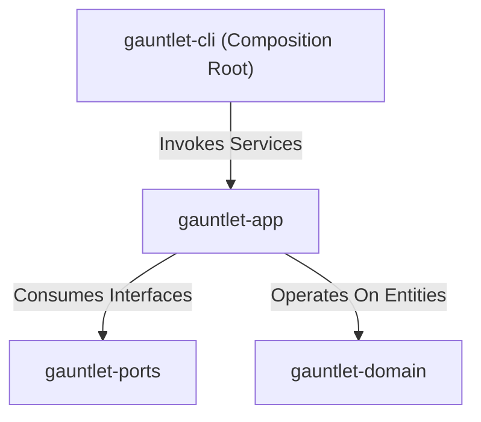
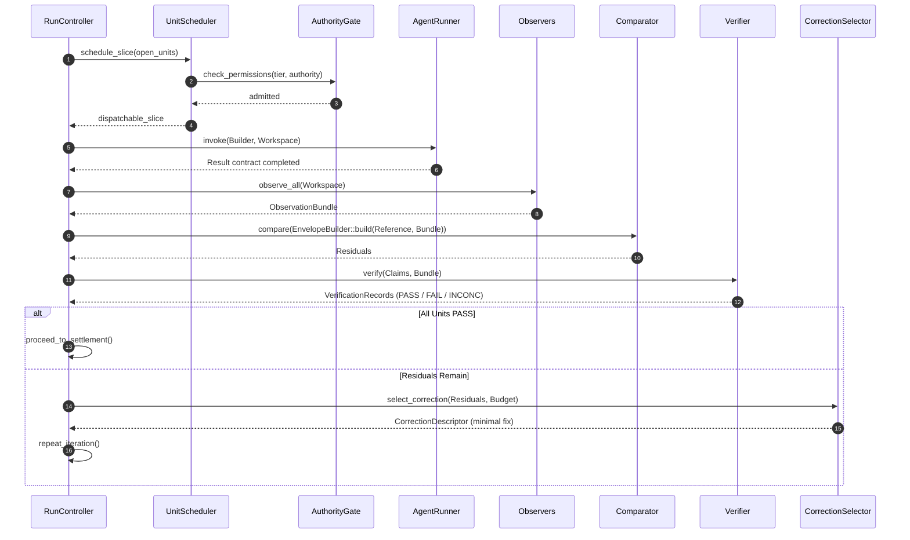

# Subsystem: Application Layer (`gauntlet-app`)

The application layer contains the core coordination services, orchestration algorithms, control state machines, and preflight verification checks of the Gauntlet runtime.

---

## 1. Purpose

The application layer coordinates the Gauntlet control cycle:
$$\text{Reference} \longrightarrow \text{Transform} \longrightarrow \text{Observe} \longrightarrow \text{Compare} \longrightarrow \text{Verify} \longrightarrow \text{Select} \longrightarrow \text{Correct} \longrightarrow \text{Settle} \longrightarrow \text{Remember}$$
It implements the non-negotiable invariants (such as structural context blindness, atomic settlement commit, and conservative budget gating) while remaining completely decoupled from concrete adapters.

---

## 2. Responsibilities

- **Run Orchestration (`control::controller`)**: Coordinates the overall execution lifecycle, manages iterations, handles clean termination, and drives crash recovery.
- **Unit Scheduling (`control::scheduler`)**: Analyzes dependency graphs, checks authority gates, and constructs safe dispatch slices.
- **Correction Selection (`control::select`)**: Evaluates candidate fixes across 10 dimensions, rejecting governance-blocked paths and selecting minimal coherent fixes.
- **Diagnostic Engine (`control::diagnosis`)**: Intervenes upon non-converging residuals to design cheap discriminating tests within the diagnostic budget.
- **Settlement Service (`settle`)**: Evaluates all 5 preconditions before settlement, re-verifies reference integrity, and performs atomic commits.
- **Reference Freezer (`reference::manifest`)**: Normalizes reference files, calculates SHA-256 digests, and generates `.gauntlet/reference.lock`.
- **Envelope Builder (`compare::envelope`)**: Assembles blind comparison envelopes from strict allowlists, stripping builder trajectory and identity.
- **Preflight Doctor (`doctor`)**: Executes the 8 mandatory checks before execution starts.
- **Config Resolution (`config`)**: Merges defaults, `GAUNTLET.md`, environment variables, and CLI flags into an `EffectiveConfig` with a `config_fingerprint`.

---

## 3. Non-Responsibilities

- **No Direct Hardware or Adapter I/O**: Does not open raw sockets, connect to databases directly, or execute shell commands without going through ports.
- **No Domain Definition**: Does not redefine domain types or value objects.
- **No CLI Argument Parsing**: Does not parse command-line arguments (owned by `gauntlet-cli`).

---

## 4. Position in the System

`gauntlet-app` depends on `gauntlet-domain` and `gauntlet-ports`. It is invoked by `gauntlet-cli` and drives execution through port interfaces.

---

## 5. Core Services and Abstractions

### `RunController` ([`control/controller.rs`](../../crates/gauntlet-app/src/control/controller.rs))
The central orchestrator. Runs preflight checks, freezes the reference, iterates through `IterationEngine`, handles recovery on restart, and enforces terminal conditions (`SETTLED`, `BLOCKED`, `BUDGET_EXHAUSTED`, `ESCALATED`, `ABORTED`, `INCONCLUSIVE`).

### `UnitScheduler` ([`control/scheduler.rs`](../../crates/gauntlet-app/src/control/scheduler.rs))
Selects which open Units are eligible for dispatch. Considers:
1. Are all dependencies (`depends_on`) settled with `Outcome::PASS`?
2. Does the role have sufficient authority?
3. Does the sandbox tier match the blast radius?
4. Inherits the highest blast radius and most restrictive authority when grouping units into slices.

### `CorrectionSelector` ([`control/select.rs`](../../crates/gauntlet-app/src/control/select.rs))
Scores candidate corrections on ten dimensions (relevance, cost, blast radius, authority, diagnostic value, recovery reserve, etc.). Eliminates governance-blocked paths first, picks the smallest fix, and records rejected alternatives with explicit reasons.

### `SettlementService` ([`settle/mod.rs`](../../crates/gauntlet-app/src/settle/mod.rs))
Enforces the 5 preconditions before settlement:
1. Zero open residuals exist for blocking units.
2. Every blocking Unit has a `VerificationRecord` with `Outcome::PASS` in this run.
3. Every `PASS` record binds to an existing, unmutated evidence artifact.
4. The Reference digest re-computed from disk matches `.gauntlet/reference.lock`.
5. The commit sequence executes in order: append event to log $\to$ write status/evidence to state store $\to$ advance in-memory state.

### `EnvelopeBuilder` ([`compare/envelope.rs`](../../crates/gauntlet-app/src/compare/envelope.rs))
Enforces Invariant I4 (structural context blindness). Given an `ObservationBundle` and a `Reference`, it constructs a `ComparisonEnvelope` containing only:
- Frozen reference projection
- Instrument observation facets (build, test, git diff, filesystem)
- Comparison contract & applicable constraints
- Relevant open residuals

It strips builder trajectory, prompt history, model identity, and prior attempt counts.

---

## 6. Execution Lifecycle of an Iteration

---

## 7. Failure Modes

| Locus | Failure Mode | Behavior |
|---|---|---|
| `ReferenceFreezer` | Reference manifest or answer key mutated mid-run. | Run aborts immediately with `TerminalState::Aborted{reference_mutated}`. |
| `AuthorityGate` | Unit requires `human` authority or exceeds sandbox tier. | Dispatch refused; escalation ticket generated in `.gauntlet/escalations/`. |
| `BudgetMeter` | Next dispatch would breach the recovery reserve (15%). | Dispatch throttled; run terminates with `TerminalState::BudgetExhausted`. |
| `SettlementService` | Missing evidence file or unverified Unit. | Settlement refused; unit marked `INCONCLUSIVE`. |

---

## Source Trail

- [`crates/gauntlet-app/src/control/controller.rs`](../../crates/gauntlet-app/src/control/controller.rs) — `RunController` implementation.
- [`crates/gauntlet-app/src/control/scheduler.rs`](../../crates/gauntlet-app/src/control/scheduler.rs) — `UnitScheduler` dependency and tier sorting.
- [`crates/gauntlet-app/src/control/select.rs`](../../crates/gauntlet-app/src/control/select.rs) — `CorrectionSelector` 10-dimension candidate scoring.
- [`crates/gauntlet-app/src/settle/mod.rs`](../../crates/gauntlet-app/src/settle/mod.rs) — `SettlementService` 5-step precondition validation and commit.
- [`crates/gauntlet-app/src/compare/envelope.rs`](../../crates/gauntlet-app/src/compare/envelope.rs) — `EnvelopeBuilder` structural blindness.
- [`crates/gauntlet-app/src/doctor/mod.rs`](../../crates/gauntlet-app/src/doctor/mod.rs) — `run_doctor` preflight verification checks.
- [`crates/gauntlet-app/src/config/mod.rs`](../../crates/gauntlet-app/src/config/mod.rs) — Layered configuration resolution and hashing.
