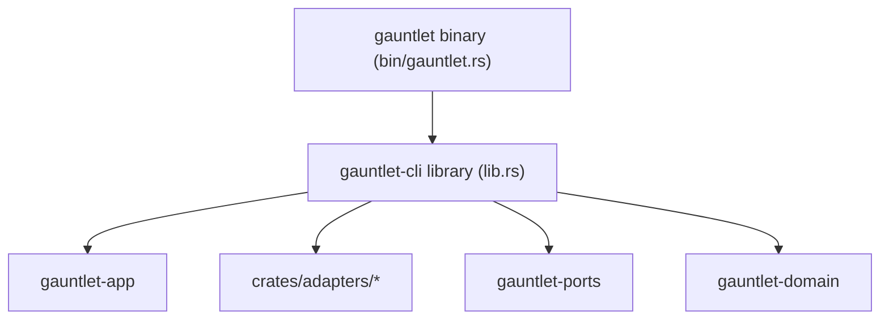

# Subsystem: CLI & Composition Root (`gauntlet-cli`)

The `gauntlet-cli` crate is the reference operator surface and the **composition root** of the Gauntlet architecture. It is the single location where concrete adapter implementations are instantiated and wired into the application layer.

---

## 1. Purpose

The CLI provides:
1. **The Human & Automated Operator Surface**: Exposes subcommands for preflight checks (`doctor`), initialization (`init`), reference management (`reference`), execution (`run`, `resume`), inspection (`status`, `inspect`), and verification (`verify`).
2. **The Architectural Composition Root**: Wires concrete adapters to application traits based on the resolved configuration and environment.

> **The Composition Invariant**: *The CLI wires; it does not decide.* All policy choices (budget math, authority admission, tier enforcement, correction ranking) live in `gauntlet-app` or `gauntlet-domain`. The CLI merely supplies facts about which adapter fronts which capability.

---

## 2. Responsibilities

- **Argument Parsing**: Standard command-line argument parsing (`std::env::args`), keeping dependencies light and startup instantaneous. Unknown arguments return exit code 2.
- **Adapter Construction**: Instantiates the 24 concrete adapters based on configuration (e.g. PostgreSQL URL, evidence root, chosen agent runner).
- **Run Composition (`compose.rs`)**: Assembles `ControllerDeps` and injects them into `RunController`.
- **Command Dispatch**: Routes commands to dedicated command modules (`doctor_cmd`, `run_cmd`, `reference_cmd`, `state_cmd`, etc.).
- **Thin Library Architecture**: Exposes `gauntlet_cli::run_cli(&[String]) -> ExitCode` as a library function so integration tests and end-to-end harnesses can drive the CLI in-process.

---

## 3. Non-Responsibilities

- **No Policy Decisions**: Does not determine what constitutes an allowable budget, whether an authority tier is safe, or what constitutes a passing test.
- **No Direct Storage Management**: Does not write SQL queries or manipulate file bytes directly; delegates to `gauntlet-app` and adapters.

---

## 4. Position in the System

`gauntlet-cli` sits at the outer edge of the dependency hierarchy. It depends on `gauntlet-domain`, `gauntlet-ports`, `gauntlet-app`, and all `crates/adapters/*`.



---

## 5. The Composition Mechanism (`compose.rs`)

The `compose.rs` module builds the unified dependency graph for a run:

```rust
// Simplified view of crates/gauntlet-cli/src/compose.rs
pub fn build_controller(ctx: &RuntimeContext) -> Result<RunController, ComposeError> {
    // 1. Instantiate state and evidence persistence
    let state_store = Arc::new(EmbeddedStateStore::open(&ctx.config.state_dir)?);
    let evidence_store = Arc::new(FsEvidenceStore::open(&ctx.config.evidence_dir)?);
    let event_log = state_store.clone(); // Implements both traits

    // 2. Select AgentRunner based on config (prime-agent, cli-agent, mock-agent)
    let runner: Arc<dyn AgentRunner> = match ctx.config.agent_runner.as_str() {
        "prime-agent" => Arc::new(PrimeAgentRunner::new(&ctx.config)?),
        "cli-agent"   => Arc::new(CliAgentRunner::new(&ctx.config)?),
        "mock-agent"  => Arc::new(MockAgentRunner::from_env()?),
        other         => return Err(ComposeError::UnknownRunner(other.into())),
    };

    // 3. Assemble observers
    let observers: Vec<Arc<dyn Observer>> = vec![
        Arc::new(BuildObserver::new()),
        Arc::new(TestObserver::new()),
        Arc::new(GitObserver::new()),
        Arc::new(FilesystemObserver::new()),
    ];

    // 4. Construct application controller
    Ok(RunController::new(
        ctx.config.clone(),
        runner,
        observers,
        state_store,
        evidence_store,
        event_log,
        // ...
    ))
}
```

---

## 6. Command Tree Overview

| Command | Module | Functionality |
|---|---|---|
| `gauntlet doctor` | [`doctor_cmd.rs`](../../crates/gauntlet-cli/src/doctor_cmd.rs) | Runs the 8 preflight checks; exits non-zero on failure. |
| `gauntlet init` | [`init_cmd.rs`](../../crates/gauntlet-cli/src/init_cmd.rs) | Generates repository skeleton (`.wayfinder/`, `GAUNTLET.md`, `.gauntlet/`). |
| `gauntlet reference` | [`reference_cmd.rs`](../../crates/gauntlet-cli/src/reference_cmd.rs) | Manages reference lifecycle: `digest`, `validate`, `form`, `freeze`, `show`, `diff`, `verify`. |
| `gauntlet run` | [`run_cmd.rs`](../../crates/gauntlet-cli/src/run_cmd.rs) | Executes a transformation loop against the frozen reference. Supports `--dry-run` and `--config`. |
| `gauntlet status` | [`state_cmd.rs`](../../crates/gauntlet-cli/src/state_cmd.rs) | Displays current execution status, iteration count, and settled units for a run. |
| `gauntlet inspect` | [`state_cmd.rs`](../../crates/gauntlet-cli/src/state_cmd.rs) | Deep inspection of specific iterations, residuals, verifications, or settlements. |
| `gauntlet verify` | [`verify_cmd.rs`](../../crates/gauntlet-cli/src/verify_cmd.rs) | Re-evaluates all units against existing evidence without invoking builders. |
| `gauntlet resume` | [`run_cmd.rs`](../../crates/gauntlet-cli/src/run_cmd.rs) | Replays event log to recover and resume an interrupted run. |
| `gauntlet escalations` | [`escalations_cmd.rs`](../../crates/gauntlet-cli/src/escalations_cmd.rs) | Lists, resolves, or retries human escalation tickets. |
| `gauntlet roles` | [`roles_cmd.rs`](../../crates/gauntlet-cli/src/roles_cmd.rs) | Installs, verifies, and lists agent role definitions across harnesses. |
| `gauntlet skills` | [`skills_cmd.rs`](../../crates/gauntlet-cli/src/skills_cmd.rs) | Installs and verifies companion skills (`grilling`, `domain-formation`, etc.). |
| `gauntlet export` | [`state_cmd.rs`](../../crates/gauntlet-cli/src/state_cmd.rs) | Exports deterministic JSONL event stream for a run. |
| `gauntlet serve` | [`serve_cmd.rs`](../../crates/gauntlet-cli/src/serve_cmd.rs) | Feature-gated (`surfaces`) JSON HTTP API server. |

---

## 7. Feature Gating: The `surfaces` Feature

By default, Gauntlet builds as a pure CLI tool (preserving minimal dependencies and fast compilation). The JSON API server (`gauntlet serve`) is guarded behind the `surfaces` cargo feature:

```toml
# In crates/gauntlet-cli/Cargo.toml
[features]
default = []
surfaces = ["gauntlet-adapter-surface-json"]
```

When built without `--features surfaces`, `gauntlet serve` is an unknown command, and no network server code is compiled into the binary.

---

## Source Trail

- [`crates/gauntlet-cli/src/lib.rs`](../../crates/gauntlet-cli/src/lib.rs) — Entry point `run_cli` and CLI usage printer.
- [`crates/gauntlet-cli/src/bin/gauntlet.rs`](../../crates/gauntlet-cli/src/bin/gauntlet.rs) — Thin executable wrapper.
- [`crates/gauntlet-cli/src/compose.rs`](../../crates/gauntlet-cli/src/compose.rs) — Concrete adapter wiring and composition root.
- [`crates/gauntlet-cli/src/context.rs`](../../crates/gauntlet-cli/src/context.rs) — `RuntimeContext` loader and environment binder.
- [`crates/gauntlet-cli/src/run_cmd.rs`](../../crates/gauntlet-cli/src/run_cmd.rs) — `run` and `resume` CLI commands.
- [`crates/gauntlet-cli/src/doctor_cmd.rs`](../../crates/gauntlet-cli/src/doctor_cmd.rs) — `doctor` CLI command.
- [`crates/gauntlet-cli/src/reference_cmd.rs`](../../crates/gauntlet-cli/src/reference_cmd.rs) — Reference subcommands.
