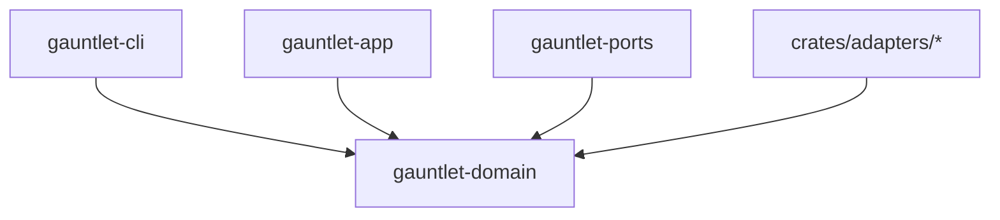

# Subsystem: Domain Layer (`gauntlet-domain`)

The domain layer defines pure domain aggregates, value objects, invariants, and state machines for the Gauntlet control runtime.

---

## 1. Purpose

The domain layer establishes the foundational types, grammar, and constructor-level invariants of Gauntlet. It guarantees that invalid execution states (e.g. an irreversible action with automated critic authority, or an `Outcome` treated as a simple boolean) are unrepresentable in the type system.

---

## 2. Responsibilities

- **Value Objects & Enums**: Defines strongly-typed identifiers (`RunId`, `UnitId`, `IterationNo`, `Digest`), statuses, outcomes, and execution tiers.
- **Aggregates**: Defines core entities (`Reference`, `Unit`, `Run`, `Iteration`, `ObservationBundle`, `ComparisonRecord`, `VerificationRecord`, `SettlementRecord`, `Budget`, `CapabilityLedger`).
- **Constructor Invariants**: Enforces mandatory constraints at creation time (e.g. `irreversible` blast radius requires `human` authority).
- **Three-State Outcome**: Enforces that verification outcomes are strictly `PASS`, `FAIL`, or `INCONCLUSIVE`, preventing boolean coercion.
- **Pure Functional Logic**: Provides pure state transition and serialization logic without side effects.

---

## 3. Non-Responsibilities

- **No I/O or Persistence**: Does not access the filesystem, databases, network, or clock.
- **No Agent Orchestration**: Does not invoke agents, spawn processes, or manage threads.
- **No External Dependencies**: Zero dependencies on third-party frameworks or other workspace crates.

---

## 4. Position in the System

The domain layer sits at the absolute core of the Hexagonal architecture. Every other crate in the workspace (`gauntlet-ports`, `gauntlet-app`, `gauntlet-cli`, and `crates/adapters/*`) depends on `gauntlet-domain`, but `gauntlet-domain` depends on nothing internal.



---

## 5. Core Abstractions

### Key Value Objects (`crates/gauntlet-domain/src/values.rs`)
- `RunId`: ULID-based lexicographically sortable identifier for a run.
- `UnitId`: Validated regex identifier (`/^[A-Z]{2,8}-[0-9]{3,6}$/`, e.g. `AK-014`).
- `Digest`: Algorithm-carrying cryptographic hash (e.g. `sha256:<hex>`). Bare hex strings are rejected.
- `Outcome`: Three-state enum: `PASS`, `FAIL`, `INCONCLUSIVE`. No `From<Outcome> for bool` exists.
- `BlastRadius`: Tier safety enum: `contained`, `local`, `cross_cutting`, `irreversible`.
- `Authority`: Execution authority: `critic`, `lead_agent`, `human`.
- `TerminalState`: Terminal outcomes: `settled`, `blocked`, `budget_exhausted`, `escalated`, `aborted`, `inconclusive`.

### Key Aggregates
- `Unit` ([`unit.rs`](../../crates/gauntlet-domain/src/unit.rs)): Represents one falsifiable claim. Enforces that `blast_radius == irreversible` implies `authority == human`, and `authority == critic` is forbidden for `cross_cutting` or `irreversible`.
- `Reference` ([`reference.rs`](../../crates/gauntlet-domain/src/reference.rs)): Represents the comparison standard, including purpose, desired state, invariants, and quality dimensions.
- `ObservationBundle` ([`observation.rs`](../../crates/gauntlet-domain/src/observation.rs)): Holds normalized facets (`versioning`, `filesystem`, `build`, `test`, `command`) and explicitly excludes `claims` from verification.
- `Budget` ([`budget.rs`](../../crates/gauntlet-domain/src/budget.rs)): Tracks limits, spent amounts, recovery reserves, and diagnostic budgets in micro-USD and token counts.

---

## 6. Internal Operation & Invariant Enforcement

Constructor-level invariants prevent invalid states from entering memory:

```rust
// In crates/gauntlet-domain/src/unit.rs
impl Unit {
    pub fn new(draft: DraftUnit) -> Result<Self, UnitError> {
        // Enforce Invariant I9: irreversible blast radius requires human authority
        if draft.blast_radius == BlastRadius::Irreversible && draft.authority != Authority::Human {
            return Err(UnitError::IrreversibleRequiresHuman);
        }
        // Enforce that critic cannot authorize cross_cutting or irreversible
        if (draft.blast_radius == BlastRadius::CrossCutting || draft.blast_radius == BlastRadius::Irreversible)
            && draft.authority == Authority::Critic {
            return Err(UnitError::CriticCannotAuthorizeTier);
        }
        // ...
    }
}
```

---

## 7. State Owned and Modified

The domain layer owns zero mutable global state. All structs are immutable values or state machine accumulators passed by value or reference.

---

## 8. Failure Modes

| Error Type | Cause | Recovery / Locus |
|---|---|---|
| `ValueError::InvalidDigest` | Digest missing algorithm prefix or non-hex string. | Caller must specify `sha256:<hash>`. |
| `ValueError::InvalidUnitId` | Unit ID does not match required regex format. | Correct ID format to `AK-###`. |
| `UnitError::IrreversibleRequiresHuman` | Attempt to construct `Unit` with `blast_radius: irreversible` and non-human authority. | Reclassify blast radius or set authority to `human`. |
| `BudgetError::ReserveBreached` | Operation would spend into the protected recovery reserve. | Throttle or halt run with `TerminalState::BudgetExhausted`. |

---

## 9. Extension Points

- **Adding a Domain Enum Variant**: When a new verification type is needed, add the variant to `VerifyBy` in `crates/gauntlet-domain/src/values.rs` and update its wire token mapping in `crates/gauntlet-domain/src/wire.rs`.
- **Adding an Invariant**: Implement validation inside the relevant aggregate's `try_new()` or `new()` constructor.

---

## Source Trail

- [`crates/gauntlet-domain/src/lib.rs`](../../crates/gauntlet-domain/src/lib.rs) — Layer entry point and module exports.
- [`crates/gauntlet-domain/src/values.rs`](../../crates/gauntlet-domain/src/values.rs) — Value objects, enums (`Outcome`, `BlastRadius`, `Authority`), and newtypes.
- [`crates/gauntlet-domain/src/unit.rs`](../../crates/gauntlet-domain/src/unit.rs) — `Unit` aggregate and tier/authority coupling validation.
- [`crates/gauntlet-domain/src/reference.rs`](../../crates/gauntlet-domain/src/reference.rs) — `Reference` aggregate, quality dimensions, and settlement criteria.
- [`crates/gauntlet-domain/src/budget.rs`](../../crates/gauntlet-domain/src/budget.rs) — `Budget`, `Limits`, `Spent`, and recovery reserve math.
- [`crates/gauntlet-domain/src/capability.rs`](../../crates/gauntlet-domain/src/capability.rs) — `CapabilityLedger` and `CandidateRevision` types.
