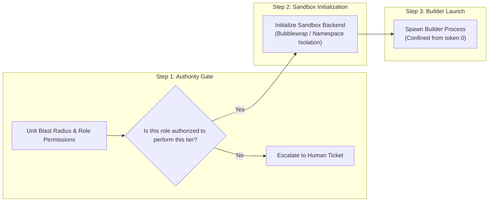

# Subsystem: Governance & Safety

The governance subsystem enforces authorization gates, OS process containment, multi-dimensional budget constraints, and human escalation queues.

---

## 1. Purpose

Autonomous agents must not possess unlimited authority, unconstrained execution budgets, or the ability to grade their own blast radius. The governance subsystem guarantees that:
1. Every action is authorized *before* process launch.
2. Every builder process is wrapped in a containment sandbox *from the first token*.
3. Every run is resource-bounded, preserving an untouchable recovery reserve.
4. High-impact or irreversible operations cannot be executed autonomously.

---

## 2. The Core Principle: Authority vs. Containment

A critical design distinction in Gauntlet is that **Authority** and **Containment** are separate, orthogonal concerns:



- **Authority** answers: *Is this action allowed to occur at all?*
- **Containment** answers: *How isolated is the process while it occurs?*

Neither substitutes for the other:
- A perfectly secure sandbox does not grant an agent permission to drop database tables.
- Having full admin permissions does not eliminate the requirement to run in an isolated worktree.

---

## 3. Blast Radius Tiers and Policies

Units declare a `blast_radius` and an `authority` level:

| Blast Radius | Permissible Authority | Sandbox Requirements | Policy File |
|---|---|---|---|
| `contained` | `critic`, `lead_agent`, `human` | Scratch workspace isolation; no host FS writes. | `.gauntlet/policies/contained.json` |
| `local` | `lead_agent`, `human` | Project worktree isolation; network blocked. | `.gauntlet/policies/local.json` |
| `cross_cutting` | `lead_agent`, `human` | Bubblewrap sandbox; repo-wide write permissions. | `.gauntlet/policies/cross_cutting.json` |
| `irreversible` | **`human` only** | **No automatic execution.** Never dispatched. | **MUST NOT EXIST** (AK-049) |

### The Irreversible Policy Invariant (AK-049)
A core safety invariant enforced by `gauntlet doctor` and `gauntlet-arch-tests` is that **no policy file may ever exist for the `irreversible` tier**. If `.gauntlet/policies/irreversible.json` is created, `gauntlet doctor` immediately fails preflight. Irreversible units can only be authorized and resolved through the human escalation queue.

### Anti-Downgrade Invariant (Anti-Gaming G7)
An agent may never lower a Unit's blast radius or authority (e.g. converting an `irreversible` deployment into a `local` task to bypass human review). The `AuthorityGate` detects and rejects any tier downgrade attempt, flagging it as a governance violation.

---

## 4. Multi-Dimensional Budget Metering

The `BudgetMeter` tracks consumption across six distinct axes:

1. **Rounds**: Maximum number of corrective iterations (`max_rounds`, default: 8).
2. **Parallelism**: Maximum concurrent builder invocations (`max_parallel`, default: 2).
3. **Depth**: Maximum recursion depth for sub-agents (`max_depth`, default: 1).
4. **Wall Clock**: Total elapsed execution time in seconds (`max_wall_seconds`, default: 3600).
5. **Tokens**: Total LLM prompt + completion token consumption (`max_tokens`, default: 2,000,000).
6. **Cost (USD)**: Total financial spend in micro-dollars (`max_cost_usd`, default: $25.00).

### The Recovery Reserve (15%)
A fixed percentage (default: 15%) of the total configured budget is quarantined as the **recovery reserve**. The runtime:
- Consults `would_breach_reserve()` before every dispatch.
- Refuses to start a new forward iteration if it would consume into the reserve.
- Keeps the reserve available exclusively for clean diagnostic runs, state rollbacks, and report generation.

If forward budget is exhausted, the run halts honestly with `TerminalState::BudgetExhausted`.

---

## 5. Human Escalation Queue

When an operation requires human intervention (e.g. an `irreversible` action, an unavailable tool, or an authority mismatch), Gauntlet creates an escalation ticket:

```text
.gauntlet/escalations/
├── pending/
│   └── TKT-01J6A7BC...json
├── resolved/
└── rejected/
```

### Ticket Lifecycle
1. **Creation**: The `AuthorityGate` writes a ticket containing the `unit_id`, `requested_tier`, `justification`, and `created_at` timestamp.
2. **Inspection**: The operator reviews open tickets:
   ```bash
   gauntlet escalations list
   ```
3. **Resolution**: The operator resolves the ticket with explicit evidence:
   ```bash
   gauntlet escalations resolve TKT-01J6A7BC... --resolution approved
   ```
4. **Resumption**: The run picks up the resolved ticket and continues execution.

> **Integrity Rule**: Operator actions pass through the exact same `SettlementService` validation path as automated settlement (AK-062). An operator cannot force a Unit to `PASS` without attaching valid evidence.

---

## Source Trail

- [`crates/gauntlet-app/src/govern/gate.rs`](../../crates/gauntlet-app/src/govern/gate.rs) — `AuthorityGate` pre-execution checks and command wrapping.
- [`crates/gauntlet-ports/src/sandbox.rs`](../../crates/gauntlet-ports/src/sandbox.rs) — `Sandbox` port trait.
- [`crates/adapters/gauntlet-adapter-sandbox-bwrap/src/lib.rs`](../../crates/adapters/gauntlet-adapter-sandbox-bwrap/src/lib.rs) — Bubblewrap process containment adapter.
- [`crates/adapters/gauntlet-adapter-meter-memory/src/lib.rs`](../../crates/adapters/gauntlet-adapter-meter-memory/src/lib.rs) — `MeteredBudget` implementation and recovery reserve math.
- [`crates/adapters/gauntlet-adapter-escalation-fs/src/lib.rs`](../../crates/adapters/gauntlet-adapter-escalation-fs/src/lib.rs) — Filesystem-backed escalation queue.
- [`crates/gauntlet-cli/src/escalations_cmd.rs`](../../crates/gauntlet-cli/src/escalations_cmd.rs) — CLI escalations handler.
