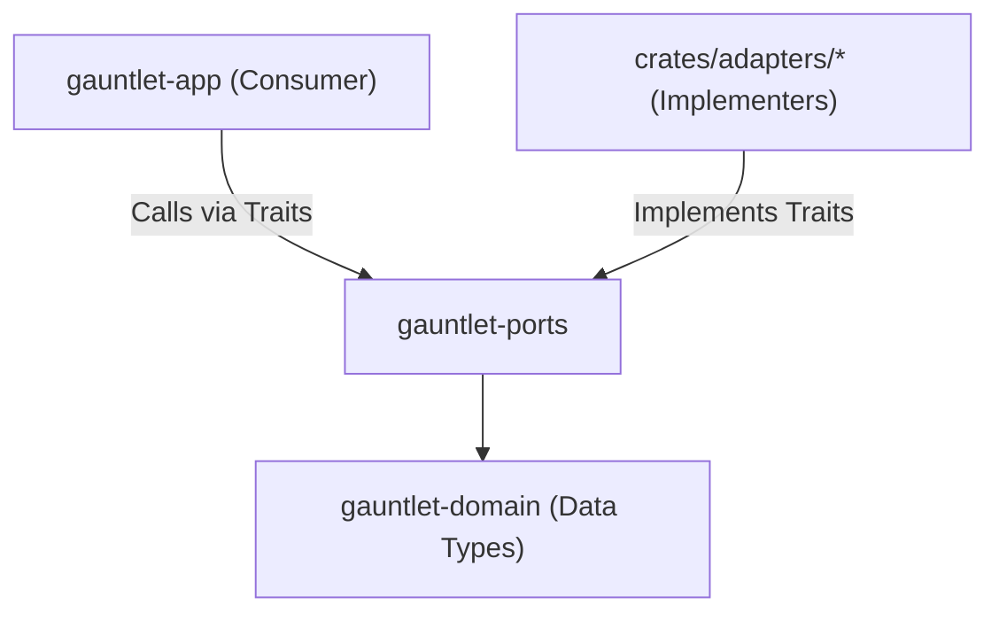

# Subsystem: Ports Layer (`gauntlet-ports`)

The ports layer defines the 17 abstract semantic capability traits that core control logic depends upon, along with their shared contract test suites.

---

## 1. Purpose

The ports layer isolates Gauntlet's core application logic from concrete tools, databases, models, and OS isolation mechanisms. It ensures that changing an agent provider, moving to a different database, or swapping Bubblewrap for a microVM requires zero changes to core control logic.

---

## 2. Responsibilities

- **Semantic Port Traits**: Defines traits representing capabilities (`AgentRunner`, `Observer`, `Comparator`, `Verifier`, `StateStore`, `EvidenceStore`, `EventLog`, `Sandbox`, `BudgetMeter`, etc.).
- **Admission-Based Agent Model**: Defines `AgentRunner` around `invoke` $\to$ `poll` $\to$ `collect_result` against a declared result-contract path.
- **Typed Errors**: Every port method returns a typed error enum carrying the failure locus (e.g. `AgentError`, `ObserverError`, `StateStoreError`). Bare strings are forbidden.
- **Shared Contract Test Suites**: Provides parameterized, reusable test suites (`crates/gauntlet-ports/src/contract/`) that every adapter must pass.
- **Strict Envelope Schemas**: Houses the typed `role_result@v1`, `comparison_record@v1`, and `facet_evidence@v1` wire definitions.

---

## 3. Non-Responsibilities

- **No Concrete Implementations**: Does not implement filesystem access, PostgreSQL calls, or process spawning.
- **No Provider Types**: No port method accepts or returns a provider-specific type (e.g., no OpenAI or Anthropic SDK types).
- **No Orchestration**: Does not decide when to invoke a port or how iterations loop.

---

## 4. Position in the System

`gauntlet-ports` depends exclusively on `gauntlet-domain`. It is consumed by `gauntlet-app` (which orchestrates calls via traits) and implemented by `crates/adapters/*`.



---

## 5. Core Port Traits

| Port Trait | Source File | Core Methods | Primary Purpose |
|---|---|---|---|
| **`AgentRunner`** | [`agent_runner.rs`](../../crates/gauntlet-ports/src/agent_runner.rs) | `invoke()`, `poll()`, `collect()`, `cancel()`, `capabilities()` | Admission-based execution of agent roles. |
| **`Observer`** | [`observer.rs`](../../crates/gauntlet-ports/src/observer.rs) | `observe_facet()`, `supported_facets()` | Collection of objective facts by instruments. |
| **`Comparator`** | [`comparator.rs`](../../crates/gauntlet-ports/src/comparator.rs) | `compare()` | Blind comparison of observations against the reference. |
| **`Verifier`** | [`verifier.rs`](../../crates/gauntlet-ports/src/verifier.rs) | `verify()` | Certification of claims against hard evidence. |
| **`StateStore`** | [`state_store.rs`](../../crates/gauntlet-ports/src/state_store.rs) | `record_run()`, `get_run()`, `record_iteration()`, `settle_unit()` | Persistence of runs, iterations, and units. |
| **`EvidenceStore`** | [`evidence_store.rs`](../../crates/gauntlet-ports/src/evidence_store.rs) | `store_evidence()`, `get_evidence()`, `pin()` | Content-addressed, write-once evidence storage. |
| **`EventLog`** | [`event_log.rs`](../../crates/gauntlet-ports/src/event_log.rs) | `append_event()`, `read_events()` | Monotonic append-only log of runtime transitions. |
| **`Sandbox`** | [`sandbox.rs`](../../crates/gauntlet-ports/src/sandbox.rs) | `validate()`, `wrap_command()`, `cleanup()` | Process isolation and containment backend. |
| **`BudgetMeter`** | [`budget_meter.rs`](../../crates/gauntlet-ports/src/budget_meter.rs) | `reserve()`, `charge()`, `remaining()`, `would_breach()` | Multi-dimensional resource and spend metering. |
| **`WorkspaceProvider`** | [`workspace_provider.rs`](../../crates/gauntlet-ports/src/workspace_provider.rs) | `create_workspace()`, `destroy_workspace()` | Provisioning isolated filesystem worktrees. |
| **`PolicyProvider`** | [`policy_provider.rs`](../../crates/gauntlet-ports/src/policy_provider.rs) | `get_tier_policy()`, `get_credential_scope()` | Loading security policies and credential scopes. |
| **`HumanEscalation`** | [`human_escalation.rs`](../../crates/gauntlet-ports/src/human_escalation.rs) | `create_ticket()`, `poll_ticket()`, `resolve_ticket()` | Managing operator escalation queues. |
| **`IdGenerator`** | [`id_generator.rs`](../../crates/gauntlet-ports/src/id_generator.rs) | `new_run_id()`, `new_invocation_id()` | Generation of ULID or seeded identifiers. |
| **`Clock`** | [`clock.rs`](../../crates/gauntlet-ports/src/clock.rs) | `now()`, `sleep_until()` | Wall-clock or deterministic virtual time. |
| **`OperatorSurface`** | [`operator_surface.rs`](../../crates/gauntlet-ports/src/operator_surface.rs) | `render_snapshot()`, `dispatch_action()` | Surface abstraction for CLI or JSON API. |

---

## 6. The Shared Contract Test Suite Pattern

A core architectural invariant (spec §7.3) is that every port ships a **shared contract test suite**:

```text
crates/gauntlet-ports/src/contract/
├── agent_runner.rs      (Tests admission, timeouts, malformed results, contract matching)
├── state_store.rs       (Tests idempotent writes, transaction safety, state queries)
├── evidence_store.rs    (Tests content addressing, immutability, pin semantics)
├── verifier.rs          (Tests 3-state outcomes, missing evidence rejection)
└── sandbox.rs           (Tests isolation validation, policy enforcement)
```

When an engineer adds a new adapter (for example, `gauntlet-adapter-agent-claude-cli`), they do not write custom tests. Instead, they run the port's existing contract suite against their adapter:

```rust
#[test]
fn test_claude_cli_passes_contract() {
    let factory = ClaudeCliAdapterFactory::new();
    gauntlet_ports::contract::agent_runner::run_all_tests(&factory);
}
```

This guarantees adapter substitutability without test suite drift.

---

## 7. The Admission-Based Runner Model

`AgentRunner` intentionally rejects blocking `run_turn()` methods. In real agentic harnesses (such as Prime-Agent), calls return an admission handle immediately, and the child agent executes asynchronously.

```rust
pub trait AgentRunner: Send + Sync {
    /// Admits a role invocation and returns a handle immediately.
    fn invoke(&self, spec: &RoleInvocationSpec) -> Result<InvocationHandle, AgentError>;

    /// Polls execution status (Running, Completed, Failed, TimedOut).
    fn poll(&self, handle: &InvocationHandle, deadline: Deadline) -> Result<InvocationStatus, AgentError>;

    /// Collects the result document from the declared contract path.
    fn collect(&self, handle: &InvocationHandle) -> Result<RoleResultDoc, AgentError>;

    /// Cancels a running invocation.
    fn cancel(&self, handle: &InvocationHandle, reason: CancelReason) -> Result<(), AgentError>;
}
```

---

## Source Trail

- [`crates/gauntlet-ports/src/lib.rs`](../../crates/gauntlet-ports/src/lib.rs) — Module exports and port declarations.
- [`crates/gauntlet-ports/src/agent_runner.rs`](../../crates/gauntlet-ports/src/agent_runner.rs) — `AgentRunner` trait and capability structs.
- [`crates/gauntlet-ports/src/contract/agent_runner.rs`](../../crates/gauntlet-ports/src/contract/agent_runner.rs) — Shared contract tests for agent runners.
- [`crates/gauntlet-ports/src/contract/state_store.rs`](../../crates/gauntlet-ports/src/contract/state_store.rs) — Shared contract tests for persistence stores.
- [`crates/gauntlet-ports/src/role_result.rs`](../../crates/gauntlet-ports/src/role_result.rs) — `role_result@v1` schema and parser.
- [`crates/gauntlet-ports/src/comparison_record.rs`](../../crates/gauntlet-ports/src/comparison_record.rs) — `comparison_record@v1` schema and aggregation types.
