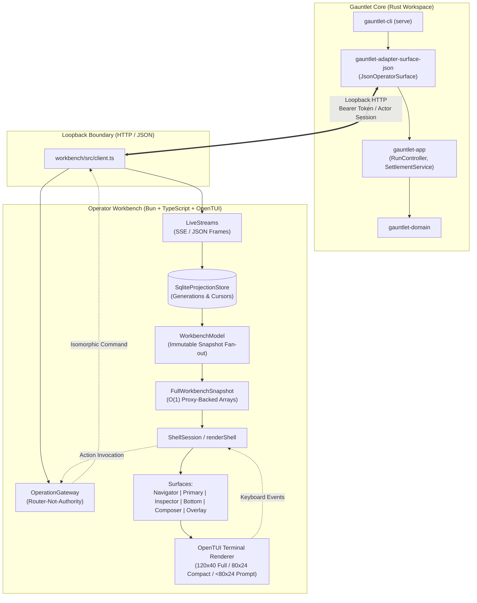
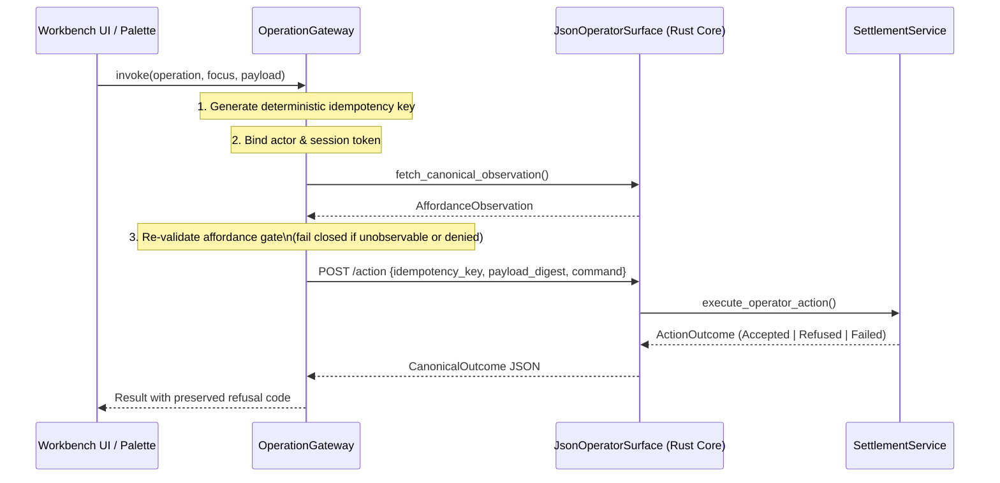

# Subsystem: Terminal-Native Operator Workbench (`workbench/`)

The Gauntlet Workbench is a terminal-native operator control plane implemented in TypeScript on Bun using OpenTUI (`@opentui/core`, `@opentui/react`). It serves as an interactive inspection, navigation, and command surface over Gauntlet core execution, Prime agent harnesses, DomainForge AST projections, and SXR RealityTrace verification.

---

## 1. Purpose

The Operator Workbench provides a unified, focus-centered perceptual plane for human operators overseeing autonomous developmental execution. It brings together work items, execution traces, evidence records, authority states, agent conversations, and spending budgets into one keyboard-driven terminal interface without sacrificing Gauntlet's strict separation between builder, observer, comparator, and verifier.

---

## 2. Responsibilities

- **Read-Model Projections**: Derives immutable presentation views (`Work`, `Chat`, `Trace`, `Evidence`, `Agents`, `Attention`, `Files`, `Kernel`, `Problems`, `Terminal`, `Domain`) from immutable snapshots without mutating or owning domain truth.
- **Router-Not-Authority Gateway**: Dispatches operator commands through `OperationGateway` using deterministic idempotency keys and pre-admission revalidation against fresh canonical observations; refuses unobservable surfaces.
- **Focus & Horizon Management**: Implements hierarchical hoisting (`h`/`u`) to narrow context, tracking stable entity identity across multiple view placements via `FocusRef`.
- **Responsive Layout & Terminal Rendering**: Enforces strict geometry thresholds (Wide $\ge 140\times 40$, Full $\ge 120\times 40$, Compact $\ge 80\times 24$, BelowMinimum $< 80\times 24$) with graceful degradation to recoverable compact-size prompts.
- **Semantic Theme Lowering**: Lowers semantic token roles (`authority.*`, `execution.*`, `settlement.*`, `evidence.*`, `brand.gold`) to truecolor, 256-color, or monochrome terminals while preserving legibility via glyph + label + emphasis + ordering.
- **Composer & Takeover States**: Manages operator text composition (`message`, `operation`, `prime`, `kernel`) and reversible takeover states (`approval`, `question`, `recovery`, `kernel-input`) without losing input drafts.
- **Reconstructible SQLite Cache**: Maintains a local SQLite database (`SqliteProjectionStore`) with generations and cursors to support cold rebuilds and reject stale event frames.

---

## 3. Non-Responsibilities

- **No Canonical State Ownership**: The workbench holds zero canonical domain truth. All authority, verification outcomes, and settlement decisions remain strictly within the Rust core engine.
- **No Optimistic Mutations**: Views never apply optimistic local updates. State transitions appear only after being committed canonically and broadcast back via snapshots or event streams.
- **No Component-Local Authority**: Individual React/OpenTUI components cannot decide whether an action is permitted. Action enablement is computed exclusively by the canonical affordance resolver (`resolveAffordance`).
- **No Bypass of Rust Governance**: The workbench cannot elevate blast radius tiers, override `AuthorityGate` checks, or bypass sandbox containment.

---

## 4. Position in the System

The Workbench package (`workbench/`) is a sibling directory to `crates/`, completely decoupled from the Cargo workspace to prevent build-scanner or symlink violations with `node_modules`. It communicates with Gauntlet core exclusively via the loopback HTTP/JSON surface (`crates/adapters/gauntlet-adapter-surface-json` enabled via `gauntlet-cli --features surfaces` or `gauntlet serve`):



---

## 5. Architectural Invariants

The workbench enforces seven core design and system invariants:

1. **Renderer Non-Authority (REQ-TUI-001, DSN-011)**: Presentation components consume immutable snapshots and emit effects. Every semantic view can be rendered by an alternate frontend without altering system semantics.
2. **Placements Over Copies (DSN-006)**: An entity (e.g. WorkItem `T23`) may appear in the Navigator, Work View, and Inspector simultaneously. Each occurrence is a `FocusPlacement` referencing one interned `FocusRef`; canonical state is never duplicated.
3. **Router, Never Second Authority (REQ-AFF-001, REQ-AFF-003)**: `OperationGateway` re-validates actions against a fresh canonical observation fetched through the same path before routing. If the surface is unobservable, it fails closed.
4. **Chat Subordinate to Trace (REQ-DATA-005, DSN-010)**: Chat and Trace are separate projections over durable history. Chat is never canonical input for Trace; disabling Chat leaves Trace byte-for-byte identical.
5. **Cold-Start Honesty (REQ-UX-001, REQ-UX-006)**: At startup, unobserved endpoints render as explicitly unavailable with reason codes and next steps, rather than pretending to be connected.
6. **Geometry Floor Conformance (DSN-007, REQ-UX-005)**: Standard layout requires at least $120\times 40$ (Full) or $80\times 24$ (Compact). Below $80\times 24$, the TUI displays a recoverable prompt with current dimensions, required floor, and clean exit without terminating background runs.
7. **No Roadmap Surfaces (DSN-015)**: The view registry rejects roadmap surfaces (such as the Harness View). Attempting to register an uncommitted roadmap identifier throws an error.

---

## 6. Component & Rendering Pipeline

### Semantic UI Ontology

The interface structure follows a strict semantic hierarchy:

```text
Environment (Global operating context)
  └── Workspace (Target case & reference scope)
        └── Surface (Stable layout region)
              └── View (Question-oriented data projection)
                    └── Focus (Specific active entity identity)
```

Orthogonal constructs cross-cut this hierarchy:
- **Cue**: Semantic indicators signalling status or pending attention.
- **Relation**: Directed graph edges connecting disparate entities (e.g. WorkItem `executed-by` Agent).
- **Affordance**: A spendable action path materialized from authoritative state.
- **Horizon**: The active perceptual boundary (narrowed via Hoist).

### Layout Geometry Classes

Terminal dimensions determine column allocation ([`geometry.ts`](../../workbench/src/geometry.ts)):

| Geometry Class | Width / Height Threshold | Surface Layout |
|---|---|---|
| **Wide** | Cols $\ge 140$, Rows $\ge 40$ | Navigator (32 cols) + Primary ($\ge 64$ cols) + Inspector (44 cols) |
| **Full** | Cols $\ge 120$, Rows $\ge 40$ | Navigator (28 cols) + Primary ($\ge 52$ cols) + Inspector (40 cols) |
| **Compact** | Cols $\ge 80$, Rows $\ge 24$ | Single Primary pane with header breadcrumbs and compact composer strip |
| **BelowMinimum** | Cols $< 80$ or Rows $< 24$ | Recoverable prompt displaying current size, minimum floor, and exit option (`q`) |

### Theme Lowering & Color Degradation

Semantic tokens are mapped to terminal representations in [`theme.ts`](../../workbench/src/theme.ts). Tokens are categorized into distinct families (`authority`, `execution`, `evidence`, `settlement`, `readiness`, `integrity`, `capability`, `attention`, `focus`, `structure`).

When terminal color capabilities degrade:
- **Truecolor**: Full RGB hex mapping (Prussian blues, slate panels, restrained amber/red, scarce gold).
- **256-color**: Pinned ANSI 256 color codes.
- **Monochrome**: Foreground/background default with **quadruple differentiation**: glyph (`✓`, `✗`, `!`, `●`, `▸`), text label, typography emphasis (`bold`, `dim`), and column ordering.

The `brand.gold` token is strictly disciplined: it is reserved exclusively for proof, independent confirmation, sanctioned authority, or explicit settlement—never for ordinary hover, selection, or decoration (`DSN-003`).

---

## 7. State & Projection Architecture

The state architecture separates fast presentation caching from durable truth:

```text
Authoritative Event Stream (JSON / SSE)
         │
         ▼
SqliteProjectionStore (bun:sqlite, WAL mode)
  ├── Generations (syncing, ready, degraded, closed)
  ├── Cursors (per-source stream offsets)
  └── Unit, Evidence, Session projection tables
         │
         ▼
WorkbenchModel (State accumulator)
  ├── Generation lifecycle management
  ├── MaterializationFoldCoordinator (off-thread background folds)
  └── Proxy-backed immutable history views (O(1) allocation)
         │
         ▼
FullWorkbenchSnapshot (Read model)
         │
   ┌─────┴──────────────────┐
   ▼                        ▼
ShellSession            Inspector & Lenses
(renderShell)           (renderInspector)
```

### Snapshot Immutability & Performance

To support high-frequency event streams without memory pressure, `WorkbenchModel` implements $O(1)$ snapshot publication using array proxies. Rather than copying the entire event history array on every event, the model bounds an immutable proxy at the publication-time length. Any attempt by UI code to mutate, push, or splice the snapshot array raises a `TypeError`.

---

## 8. Interaction & Input Model

Input flows through a deterministic event loop in `ShellSession.handleKey()` ([`shell.ts`](../../workbench/src/shell.ts)):

1. **Geometry Interception**: If dimensions are `BelowMinimum`, only `q` (quit) is processed.
2. **Command Palette (`p`)**: When the palette overlay is open, input routes to search, selection, and palette execution (`Enter`).
3. **View Switching (`1`, `2`, `3`)**: Direct numerical keys switch the Primary surface between `work` (1), `chat` (2), and `trace` (3).
4. **Surface Traversal (`Tab`)**: Cycles focus sequentially through active surfaces: `Navigator` $\rightarrow$ `Primary` $\rightarrow$ `Inspector` $\rightarrow$ `Composer`.
5. **Selection & Hoisting**:
   - `Up` / `Down`: Moves cursor in Navigator or scrolls active View.
   - `Enter`: Selects the item under the cursor as active `Focus`.
   - `h`: Hoists the active Focus into the new Horizon breadcrumb.
   - `u`: De-hoists back to the parent Horizon.
6. **Composer Takeover (`e`)**: Activates composer focus. If a critical event requires human input (e.g. escalation ticket or confirmation), a `TakeoverRequest` takes temporary precedence; completing or dismissing (`Esc`) the takeover restores the prior draft and mode.

---

## 9. Operation Gateway (`operation-gateway.ts`)

Consequential mutations flow through `OperationGateway.drive()`:



---

## 10. Failure Modes & Error Handling

| Symptom | Underlying Cause | Subsystem Layer | Recovery Mechanism |
|---|---|---|---|
| Recoverable compact prompt displayed | Terminal geometry $< 80\times 24$ | Geometry layer | Enlarge terminal window to $\ge 80\times 24$; state and running jobs are preserved. |
| Actions show "Unavailable: surface unobservable" | Loopback HTTP service unreachable or `gauntlet serve` not running | Operation Gateway | Run `just tui-dev-up` (builds + starts the surface, bind via `GAUNTLET_API_BIND`, no `--port` flag) or verify `GAUNTLET_ENDPOINT` matches. |
| Stale frame rejected error | Event frame received from superseded generation ID | Projection Store | Store automatically drops frame; trigger cold rebuild if desynchronized. |
| Terminal left in raw mode after panic | Process terminated abnormally before `restoreTerminal()` | Terminal Host | Run `reset` or `stty sane` in host shell to restore echo and line buffering. |
| Focus trapped in takeover modal | Subagent takeover waiting on missing response | Composer Layer | Press `Esc` to dismiss temporary takeover and recover held draft. |

---

## 11. Source Trail

- [`workbench/src/main.ts`](../../workbench/src/main.ts) — Terminal process entry point, raw mode toggle, and render loop.
- [`workbench/src/shell.ts`](../../workbench/src/shell.ts) — Semantic shell, view switching, keyboard dispatch, surface layout.
- [`workbench/src/workbench-model.ts`](../../workbench/src/workbench-model.ts) — State accumulator, generation lifecycle, snapshot publication.
- [`workbench/src/projection-store.ts`](../../workbench/src/projection-store.ts) — SQLite schema, generation cursors, provenance preservation.
- [`workbench/src/operation-gateway.ts`](../../workbench/src/operation-gateway.ts) — Isomorphic gateway, idempotency key generation, admission re-check.
- [`workbench/src/affordance.ts`](../../workbench/src/affordance.ts) — Affordance descriptor resolution, reason codes, next steps.
- [`workbench/src/geometry.ts`](../../workbench/src/geometry.ts) — Responsive classification, column budgeting, below-minimum prompt.
- [`workbench/src/theme.ts`](../../workbench/src/theme.ts) — Semantic token palette, degradation lowering, gold discipline.
- [`workbench/src/composer.ts`](../../workbench/src/composer.ts) — Composer state machine, temporary takeover management.
- [`workbench/src/inspector.ts`](../../workbench/src/inspector.ts) — Focus record rendering, relation graph projection, lens wiring.
