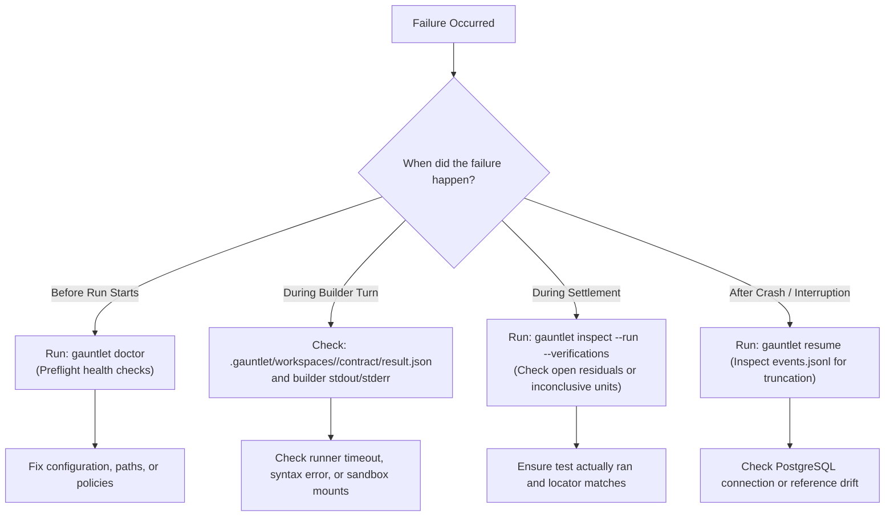

# Operational Troubleshooting Guide

This guide provides diagnostic procedures, symptoms, causes, and recovery steps for common failures in the Gauntlet runtime.

---

## 1. Quick Diagnostic Decision Tree



---

## 2. Common Symptoms, Causes, and Solutions

### 1. `gauntlet doctor` Fails on Preflight

#### Symptom: Check 2 (Reference) fails with `digest mismatch`
- **Cause**: `.wayfinder/reference.yaml` or `.wayfinder/answer-key.md` was edited after freezing, or line endings changed from LF to CRLF.
- **Diagnosis**:
  ```bash
  gauntlet reference diff --path .wayfinder/answer-key.md --against .gauntlet/reference.lock
  ```
- **Recovery**: Revert uncommitted edits to match the frozen lock file:
  ```bash
  git checkout -- .wayfinder/
  ```

#### Symptom: Check 5 (Sandbox Policies) fails with `top-tier policy exists`
- **Cause**: A policy file named `irreversible.json` exists in `.gauntlet/policies/`. Invariant AK-049 strictly forbids top-tier policies.
- **Recovery**: Delete the file immediately:
  ```bash
  rm .gauntlet/policies/irreversible.json
  ```

#### Symptom: Check 7 (Writable Paths) fails with `answer key inside workspace`
- **Cause**: The answer key path was placed inside the builder's writable workspace directory.
- **Recovery**: Ensure `GAUNTLET_ARTIFACT_DIR` and `GAUNTLET_WORKSPACE_ROOT` point to separate paths outside `.wayfinder/`.

---

### 2. Run Halts in Non-Settled Terminal States

#### Symptom: `TerminalState::BudgetExhausted`
- **Cause**: Forward iterations consumed all allowable tokens/USD or breached the 15% recovery reserve.
- **Diagnosis**:
  ```bash
  gauntlet status --run <run-id>
  ```
- **Recovery**:
  1. Inspect whether the builder is thrashing on an unresolvable compile error.
  2. If the task genuinely requires more budget, increase limits in `GAUNTLET.md` or set:
     ```bash
     export GAUNTLET_BUDGET_MAX_COST_USD=50
     ```
  3. Resume the run:
     ```bash
     gauntlet resume <run-id>
     ```

#### Symptom: `TerminalState::Escalated`
- **Cause**: A Unit declared `blast_radius: irreversible` or `authority: human`, or the sandbox backend refused an uncontained dispatch.
- **Diagnosis**:
  ```bash
  gauntlet escalations list
  ```
- **Recovery**:
  1. Inspect the ticket in `.gauntlet/escalations/pending/`.
  2. Resolve the ticket with approval evidence:
     ```bash
     gauntlet escalations resolve <ticket-id> --resolution approved --evidence <path>
     ```
  3. Resume the run:
     ```bash
     gauntlet resume <run-id>
     ```

#### Symptom: `TerminalState::Aborted { reference_mutated }`
- **Cause**: Invariant I1 triggered. A builder process attempted to modify `.wayfinder/answer-key.md` or `.wayfinder/reference.yaml` during its turn.
- **Diagnosis**: Inspect git diff in the temporary workspace:
  ```bash
  git status /tmp/gauntlet/workspaces/<run-id>/
  ```
- **Recovery**: The run is permanently invalidated. Fix the builder's prompt or tools to prevent touching `.wayfinder/`, and launch a new run.

---

### 3. Verification & Settlement Issues

#### Symptom: Unit remains `INCONCLUSIVE` despite tests passing
- **Cause**: Evidence binding failed. The test report locator in `answer-key.md` did not match the test name emitted by the test runner, or the report was stale.
- **Diagnosis**:
  ```bash
  gauntlet inspect --run <run-id> --unit <unit-id> --verifications
  ```
- **Fix**: Check `evidence_required.locator` in `.wayfinder/answer-key.md`. Ensure it matches the exact test function name (e.g. `tests/auth.rs::test_account_lockout`).

#### Symptom: `ConcurrentWriteDetected` on startup or resume
- **Cause**: A previous Gauntlet process crashed without releasing its state-store connection, or another instance is running in the same directory.
- **Diagnosis**:
  ```bash
  ls -la /tmp/gauntlet/state/*.lock
  ```
- **Recovery**: Ensure no other `gauntlet` process is running (`pkill gauntlet` or kill the PID), then remove stale lock files.

---

### 4. Operator Workbench & TUI Issues

#### Symptom: Terminal input invisible or prompt garbled after crash
- **Cause**: The workbench terminated abruptly before `restoreTerminal()` could disable raw mode (`setRawMode(false)`) or re-enable cursor visibility (`\x1b[?25h`).
- **Recovery**: Run the standard terminal reset sequence blindly in your shell:
  ```bash
  stty sane && reset
  ```

#### Symptom: Screen locked displaying "Gauntlet needs at least 80x24"
- **Cause**: Geometry class degraded to `BelowMinimum` (terminal width $< 80$ columns or height $< 24$ rows). Per `DSN-007` and `REQ-UX-005`, the workbench halts rendering to prevent layout corruption.
- **Recovery**:
  1. Enlarge or maximize your terminal emulator window.
  2. As soon as dimensions reach $80\times 24$, the workbench automatically re-enters the active View with Focus and Horizon intact.
  3. Alternatively, press `q` to quit cleanly; running background engine jobs are not cancelled.

#### Symptom: All affordances report "unavailable: surface unobservable"
- **Cause**: The workbench cannot reach the Gauntlet core loopback HTTP/JSON surface. `OperationGateway` fails closed when the surface is unreachable (`REQ-AFF-003`).
- **Diagnosis**: Verify whether `gauntlet serve` is active (there is no `/health` route; probe
  a real §20.2 endpoint):
  ```bash
  curl -i http://127.0.0.1:4000/api/v1/capabilities
  ```
- **Recovery**:
  1. Easiest: `just tui-dev-up` builds, starts, and waits for the core surface, then launches
     the workbench — see `docs/how-to/operate-the-tui.md`. `just tui-dev-down` stops it.
  2. Manually: build with the `surfaces` feature and launch in another window —
     `GAUNTLET_API_BIND=127.0.0.1:4000 cargo run -p gauntlet-cli --features surfaces -- serve`
     (there is no `--port` flag; the bind comes only from `GAUNTLET_API_BIND`, and it must
     already have at least one composed `gauntlet run` to open its durable state).
  3. If using a custom bind, configure `export GAUNTLET_ENDPOINT="http://127.0.0.1:<port>"`
     to match before starting the workbench.

#### Symptom: Composer takeover prompt trapped or cannot be closed
- **Cause**: A subagent approval or question takeover is waiting on an unanswered request ID.
- **Recovery**: Press `Esc` to dismiss the temporary takeover modal (`composerDismissTakeover`). The workbench will restore your previous draft text and composer mode.

---

## Source Trail

- [`crates/gauntlet-app/src/doctor/mod.rs`](../../crates/gauntlet-app/src/doctor/mod.rs) — Doctor checks implementation.
- [`crates/gauntlet-app/src/control/diagnosis.rs`](../../crates/gauntlet-app/src/control/diagnosis.rs) — Diagnostic engine.
- [`crates/gauntlet-cli/src/escalations_cmd.rs`](../../crates/gauntlet-cli/src/escalations_cmd.rs) — Escalation queue inspection and resolution.
- [`crates/gauntlet-cli/src/state_cmd.rs`](../../crates/gauntlet-cli/src/state_cmd.rs) — Run status and entity inspection.
- [`workbench/src/main.ts`](../../workbench/src/main.ts) — Terminal mode restoration and below-minimum prompt rendering.
- [`workbench/src/operation-gateway.ts`](../../workbench/src/operation-gateway.ts) — Gateway failure closed on unobservable surface.
- [`workbench/src/composer.ts`](../../workbench/src/composer.ts) — Composer takeover state and escape dismissal.

