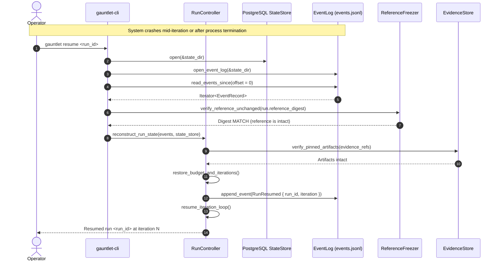

# Workflow: Crash Recovery & Resumption (`gauntlet resume`)

This document details how Gauntlet recovers from unexpected process crashes, power failures, or machine reboots without losing state or relying on conversational memory.

---

## 1. Summary

In standard agent harnesses, restarting an interrupted session results in amnesia: the orchestrator asks the model "remind me what we were doing," leading to re-doing already-settled work, skipping unverified steps, or hallucinating progress.

Gauntlet preserves **Invariant I11**: *Critical state is never reconstructed from conversational memory.* Every iteration boundary and settlement is durably committed to an append-only event log (`fsync` on commit) and an embedded PostgreSQL database. Resuming a run (`gauntlet resume <run_id>`) replays the event log from disk, re-verifies reference integrity, and picks up exactly where execution left off.

---

## 2. Recovery Sequence Diagram



---

## 3. The Three-Step Atomic Settlement Commit

To guarantee that crash recovery is crash-proof even at the moment of settlement, Gauntlet follows a strict three-step commit order (spec §16.3):

```text
Step 1: Durable Event Append  ──►  Step 2: State Store Write  ──►  Step 3: In-Memory Advance
(events.jsonl + fsync)             (PostgreSQL transaction)            (Advance controller pointers)
```

If the system crashes:
- **Before Step 1**: The settlement did not happen; on resume, the unit is still `open` and verification re-runs.
- **Between Step 1 and Step 2**: The event log contains the settlement event with `(run_id, unit_id, verification_ref)`. On resume, the log replay detects the event and reconciles the PostgreSQL database idempotently.
- **After Step 2**: Both log and state store record the settlement; in-memory pointers are reloaded immediately.

Replay is guaranteed to be idempotent. An already-settled Unit is never re-dispatched.

---

## 4. Recovery Verification Steps

When `gauntlet resume <run_id>` executes:

1. **Lock Verification**: Checks `writer_lock.rs` to ensure no other active Gauntlet process is currently writing to the run.
2. **Event Log Replay**: Reads `events.jsonl` from line 0 to EOF:
   - Reconstructs `RunDefinition`, `IterationNo`, and `Budget` spent amounts.
   - Restores open residuals and settled units.
3. **Reference Integrity**: Compares the run's recorded `reference_digest` against `.gauntlet/reference.lock` and `.wayfinder/reference.yaml`. If the ruler moved while the system was down, resumption aborts immediately with `reference_mutated`.
4. **Evidence Pin Check**: Confirms that all `EvidenceRef`s referenced in settled units still resolve to byte-identical files in the evidence store.
5. **Resume Event**: Appends an explicit `RunResumed` event to the log.
6. **Execution Continuation**: Enters the iteration loop at iteration $N+1$.

---

## 5. Crash-Injection Proof Test (P7)

Gauntlet's recovery mechanism is continuously tested under simulated crashes via `crates/gauntlet-cli/tests/p7_recovery.rs`:
- Crash injection points are placed between every commit step.
- The process is killed with `SIGKILL` mid-settlement.
- `gauntlet resume` is invoked and asserted to achieve exactly-once settlement with zero orphaned records.

---

## Source Trail

- [`crates/gauntlet-app/src/control/controller.rs`](../../crates/gauntlet-app/src/control/controller.rs) — `RunController::resume`.
- [`crates/gauntlet-app/src/settle/mod.rs`](../../crates/gauntlet-app/src/settle/mod.rs) — 3-step atomic commit implementation.
- [`crates/adapters/gauntlet-adapter-state-postgres/src/event_log.rs`](../../crates/adapters/gauntlet-adapter-state-postgres/src/lib.rs) — Append-only event log with `fsync`.
- [`crates/gauntlet-cli/tests/p7_recovery.rs`](../../crates/gauntlet-cli/tests/p7_recovery.rs) — Executable crash-recovery proof test.
