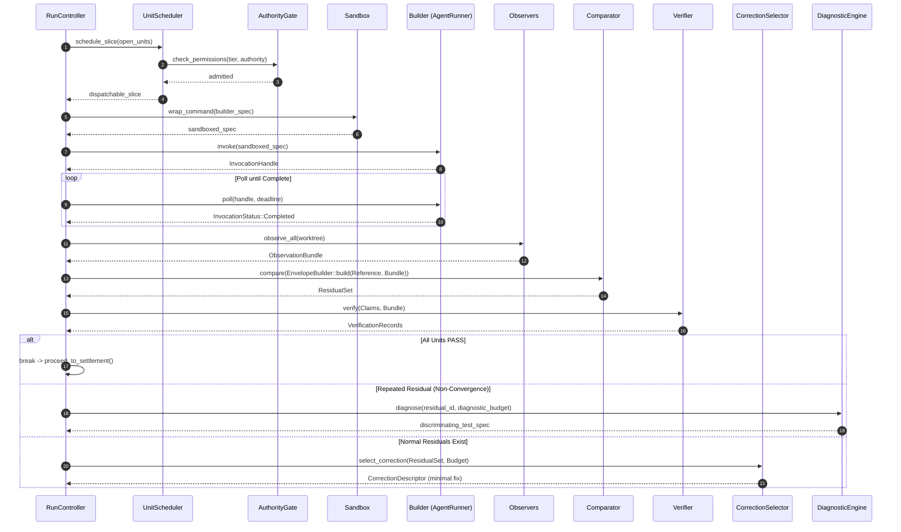

# Workflow: Iteration Loop Execution

This document provides a fine-grained trace of a single corrective iteration within a Gauntlet run.

---

## 1. Summary

An iteration represents one execution cycle of the Gauntlet control invariant:
$$\text{Schedule} \longrightarrow \text{Dispatch/Transform} \longrightarrow \text{Observe} \longrightarrow \text{Compare} \longrightarrow \text{Verify} \longrightarrow \text{Select Correction}$$
The iteration takes the open Unit set, dispatches a builder in an isolated sandbox, gathers objective instrument observations, performs blind comparison to find residuals, certifies claims against evidence, and selects the next minimal correction.

---

## 2. Sequence Diagram

---

## 3. Detailed Execution Sequence

### Step 1: Scheduling & Authority Gating
- `UnitScheduler::schedule_slice` filters open units whose dependencies have settled with `Outcome::PASS`.
- `AuthorityGate::admit` verifies:
  - If `blast_radius == irreversible`, refuse dispatch and create an escalation ticket.
  - If `authority == critic` and tier is above `contained`, refuse dispatch.
  - If the agent attempted to lower a tier, record a governance violation.

### Step 2: Builder Dispatch & Containment
- `Sandbox::wrap_command` constructs the Bubblewrap arguments (mounting `/` read-only, binding `/tmp/gauntlet/workspaces/<run>/<iter>` read-write, isolating network).
- `AgentRunner::invoke` admits the task and returns an `InvocationHandle`.
- The controller polls until `InvocationStatus::Completed`, then reads the result contract file.

### Step 3: Observation Assembly
- Observers execute in parallel across facets:
  - `BuildObserver`: executes compiler checks.
  - `TestObserver`: executes nextest / test suite.
  - `GitObserver`: checks `git diff --stat` and uncommitted trees.
  - `FilesystemObserver`: hashes changed artifacts.
- `Assembly::assemble_bundle` bundles facets into an `ObservationBundle`, computing the `observation_digest`.
- Any text generated by the builder is placed in `claims_facet` with `excluded_from_verification: true`.

### Step 4: Blind Comparison
- `EnvelopeBuilder::build_envelope` filters the observation bundle against an allowlist:
  - Allowed: Reference projection, instrument facets, comparison contract, active constraints.
  - Denied: Builder reasoning, prompt history, model identity, prior iteration counts.
- `Comparator::compare` inspects the envelope and emits a `ResidualSet`.

### Step 5: Verification & Evidence Binding
- `Verifier::verify` checks each unit's claim against its `evidence_required` specification:
  - Locates the matching evidence artifact in the bundle.
  - Verifies that the artifact was produced *during or after* this iteration's transform (rejecting stale evidence).
  - Verifies that the producer matches (`instrument` vs `human`).
  - Produces `VerificationRecord` with `Outcome::PASS`, `Outcome::FAIL`, or `Outcome::INCONCLUSIVE`.

### Step 6: Correction Selection or Diagnosis
- If the same residual has failed $N$ times (`nonconvergence_n`, default: 3):
  - Execution routes to `DiagnosticEngine`.
  - The diagnostic engine consumes a slice of `diagnostic_budget` to run discriminating boundary tests.
- Otherwise, `CorrectionSelector::select_correction` evaluates candidate fixes across 10 dimensions, selects the minimal coherent fix, and advances to the next iteration.

---

## 4. State Changes Within an Iteration

1. `Run.iterations`: Incremented by 1.
2. `Budget.spent`: Debited for tokens, execution time, and tool calls.
3. `Unit.status`: Remains `InProgress` or transitions to `Settled` upon passing verification.
4. `EventLog`: Records `IterationStarted`, `BuilderInvoked`, `ObservationsCollected`, `ComparisonCompleted`, `VerificationCompleted`, and `CorrectionSelected`.

---

## Source Trail

- [`crates/gauntlet-app/src/control/controller.rs`](../../crates/gauntlet-app/src/control/controller.rs) — `RunController::execute_iteration`.
- [`crates/gauntlet-app/src/control/scheduler.rs`](../../crates/gauntlet-app/src/control/scheduler.rs) — `UnitScheduler`.
- [`crates/gauntlet-app/src/control/select.rs`](../../crates/gauntlet-app/src/control/select.rs) — `CorrectionSelector`.
- [`crates/gauntlet-app/src/control/diagnosis.rs`](../../crates/gauntlet-app/src/control/diagnosis.rs) — `DiagnosticEngine`.
- [`crates/gauntlet-app/src/compare/envelope.rs`](../../crates/gauntlet-app/src/compare/envelope.rs) — `EnvelopeBuilder`.
- [`crates/gauntlet-app/src/verify/ladder.rs`](../../crates/gauntlet-app/src/verify/ladder.rs) — Verifier selection ladder.
