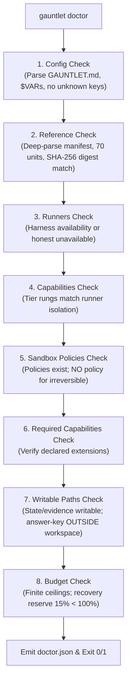

# Workflow: Preflight Doctor (`gauntlet doctor`)

This document details the preflight verification checks executed by `gauntlet doctor` before any execution begins.

---

## 1. Summary

The preflight subsystem (`crates/gauntlet-app/src/doctor/`) runs 8 comprehensive checks to prove environment health, configuration validity, reference integrity, and safety invariants *before* spending tokens or spawning processes. It generates both a human-readable terminal report and a machine-readable `.agents/reports/doctor.json`. Any failure in a required check causes an immediate non-zero exit.

---

## 2. The 8 Mandatory Preflight Checks



---

## 3. Detailed Path and Criteria

### Check 1: Configuration (`config`)
- **Parses Front Matter**: Resolves `GAUNTLET.md` YAML front matter.
- **Validates Keys**: Asserts zero unknown keys in the configuration mapping. Lenient ignoring of keys is forbidden.
- **Environment Indirections**: Resolves `$VAR` references, ensuring required secrets are present in the environment without logging their values.

### Check 2: Reference Integrity (`reference`)
- **Manifest Deep Parse**: Validates `.wayfinder/reference.yaml` structure.
- **Answer Key Count**: Validates `.wayfinder/answer-key.md` contains all 70 checkable Units ($AK\text{-}001 \dots AK\text{-}070$).
- **Unit Schema**: Verifies every Unit complies with the spec §5.3.2 schema (e.g. `irreversible` requires `human` authority).
- **Cryptographic Digest**: Computes the normalized SHA-256 digest and asserts an exact byte match against `.gauntlet/reference.lock`.

### Check 3: Runners (`runners`)
- Verifies that the configured runner (`prime-agent`, `cli-agent`, or `mock-agent`) is present in the environment.
- If no runner is configured (e.g. during early bootstrap), reports `unavailable` honestly rather than inventing a fake default.

### Check 4: Capabilities (`capabilities`)
- Compares the required tier rungs against the runner's reported `RunnerCapabilities.isolation`.
- Confirms that if `isolation == none`, only tier `contained` is dispatchable without an escalation ticket.

### Check 5: Sandbox Policies (`sandbox policies`)
- **The Top-Tier Invariant (AK-049)**: Confirms that **no policy file exists for the `irreversible` tier** (`.gauntlet/policies/irreversible.json`). Its presence is a fatal configuration error.
- **Tier Policies**: When a sandbox backend is configured (e.g. Bubblewrap), verifies that policy files exist for `contained`, `local`, and `cross_cutting`.

### Check 6: Required Capabilities (`required capabilities`)
- Validates any custom tool or runtime capabilities declared in `GAUNTLET.md`.

### Check 7: Writable Paths & Ruler Placement (`writable paths`)
- **Path Probes**: Probes `state_dir`, `evidence_dir`, and `workspace_root` by writing, reading, and removing a scratch file.
- **Ruler Isolation**: Proves that `.wayfinder/answer-key.md` is **outside every builder-writable workspace root** (both lexically and canonically).

### Check 8: Budget Limits (`budget`)
- Verifies that all budget dimensions have finite, conservative ceilings.
- Validates that `recovery_reserve_pct` is strictly between 1% and 99% (default: 15%).
- Verifies that `diagnostic_budget` is a positive integer.

---

## 4. Sample Diagnostic Output

```text
$ gauntlet doctor
gauntlet doctor (spec 8.5 preflight)
  1. config                   pass
      - front matter parses  pass
      - unknown keys         pass
      - indirections         pass
  2. reference                pass
      - manifest             pass
      - answer key           pass (70 units)
      - digest               pass (sha256:ccc7c99... matches .gauntlet/reference.lock)
  3. runners                  pass (mock-agent available)
  4. capabilities             pass (tier rungs match runner isolation)
  5. sandbox policies         pass (no top-tier policy)
  6. required capabilities    pass
  7. writable paths           pass
      - state dir            pass (/tmp/gauntlet/state)
      - evidence dir         pass (/tmp/gauntlet/evidence)
      - answer key placement pass (outside builder workspaces)
  8. budget                   pass (ceilings finite, recovery reserve 15%)
exit: OK
report: .agents/reports/doctor.json
```

---

## Source Trail

- [`crates/gauntlet-app/src/doctor/mod.rs`](../../crates/gauntlet-app/src/doctor/mod.rs) — Core `run_doctor` implementation.
- [`crates/gauntlet-cli/src/doctor_cmd.rs`](../../crates/gauntlet-cli/src/doctor_cmd.rs) — CLI wrapper for `doctor`.
- [`crates/gauntlet-app/src/config/gauntlet_md.rs`](../../crates/gauntlet-app/src/config/gauntlet_md.rs) — Front-matter parser and indirection resolver.
- [`crates/gauntlet-app/src/reference/manifest.rs`](../../crates/gauntlet-app/src/reference/manifest.rs) — Reference digest comparison against lock.
