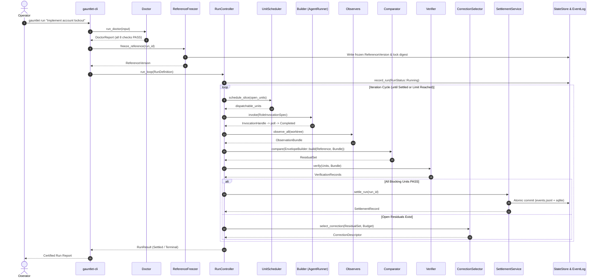

# Workflow: End-to-End Run Lifecycle

This document traces the complete execution lifecycle of a Gauntlet run from initial command invocation to certified settlement or terminal halt.

---

## 1. Summary

The end-to-end run lifecycle takes an operator's transformation request, verifies preflight health, locks the reference ruler, and enters a bounded loop of scheduling, building, observing, comparing, verifying, and correcting. Execution terminates either in verified `SETTLED` status with immutable evidence and developmental memory, or in an honest terminal halt (`BLOCKED`, `BUDGET_EXHAUSTED`, `ESCALATED`, `ABORTED`, or `INCONCLUSIVE`).

---

## 2. Sequence of Execution



---

## 3. Detailed Execution Path

1. **CLI Invocation**:
   - Entry point: `gauntlet_cli::run_cli` in [`crates/gauntlet-cli/src/lib.rs`](../../crates/gauntlet-cli/src/lib.rs).
   - Dispatches to `gauntlet_cli::run_cmd::run`.
2. **Preflight Checks**:
   - `gauntlet_app::doctor::run_doctor` runs the 8 checks: config parsing, reference existence, runner availability, capability tiers, sandbox policy validity, writable paths, budget ceilings.
3. **Reference Freeze**:
   - `gauntlet_app::reference::manifest::ReferenceFreezer` normalizes `.wayfinder/reference.yaml` and `.wayfinder/answer-key.md`.
   - Recomputes SHA-256 digest and compares against `.gauntlet/reference.lock`.
   - Pins the frozen copy in the immutable evidence store (`/tmp/gauntlet/evidence/`).
4. **Controller Launch**:
   - `gauntlet_cli::compose::build_controller` wires adapters into `gauntlet_app::control::controller::RunController`.
   - Creates a new `RunId` (ULID) and writes the initial event to `EventLog`.
5. **Iteration Loop**:
   - Controlled by `RunController::execute_iteration`.
   - Iterates through `UnitScheduler` $\to$ `AgentRunner` $\to$ `Observer` $\to$ `Comparator` $\to$ `Verifier` $\to$ `CorrectionSelector`.
6. **Precondition & Settlement**:
   - When all blocking units have `Outcome::PASS`, `SettlementService::evaluate_preconditions` validates that:
     1. Zero open blocking residuals exist.
     2. Every blocking Unit has a `PASS` verification record in this run.
     3. Every evidence artifact exists and is unmutated.
     4. The Reference digest re-read from disk matches the freeze record.
   - Commits an atomic settlement transaction.
7. **Reporting & Memory**:
   - Emits a machine-readable run report (`.agents/reports/run-<run_id>.json`).
   - Appends run metrics and residual histories to developmental memory.

---

## 4. State Transitions

```text
Run:        Created ──► Running ──► Settled
                                └──► Blocked | BudgetExhausted | Escalated | Aborted | Inconclusive

Unit:       Open ──► InProgress ──► Settled
                                └──► Blocked | OutOfScope

Outcome:    Inconclusive ──► Pass
                         └──► Fail
```

---

## 5. Failure Branches

- **Preflight Failure**: If any required doctor check fails (e.g. answer key is inside a builder-writable path), the command halts with exit code 1 without creating a run.
- **Reference Mutation**: If a builder modifies the answer key mid-run, `verify_unchanged` fails at the iteration boundary. The run terminates with `TerminalState::Aborted{reference_mutated}`.
- **Budget Exhaustion**: If the remaining budget hits the 15% recovery reserve, `would_breach_reserve()` triggers, halting the run with `TerminalState::BudgetExhausted`.
- **Irreversible Operation**: If a unit has `blast_radius: irreversible`, the `AuthorityGate` halts automated execution and writes an escalation ticket, transitioning the run to `TerminalState::Escalated`.

---

## Source Trail

- [`crates/gauntlet-cli/src/run_cmd.rs`](../../crates/gauntlet-cli/src/run_cmd.rs) — `gauntlet run` entry point.
- [`crates/gauntlet-app/src/control/controller.rs`](../../crates/gauntlet-app/src/control/controller.rs) — `RunController::run_loop`.
- [`crates/gauntlet-app/src/reference/manifest.rs`](../../crates/gauntlet-app/src/reference/manifest.rs) — `ReferenceFreezer`.
- [`crates/gauntlet-app/src/settle/mod.rs`](../../crates/gauntlet-app/src/settle/mod.rs) — `SettlementService`.
- [`crates/gauntlet-ports/src/event_log.rs`](../../crates/gauntlet-ports/src/event_log.rs) — `EventLog::append_event`.
