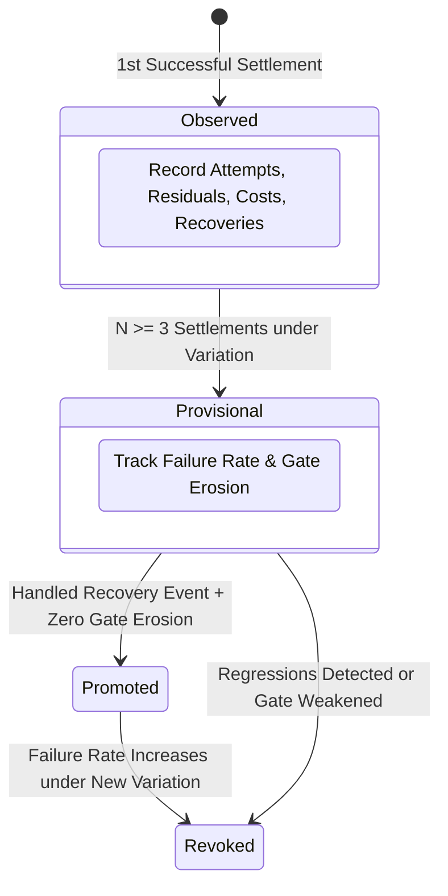

# Workflow: Settlement & Capability Promotion

This document details how Gauntlet authorizes settlement, certifies completion claims with durable evidence, and governs the promotion of raw experience into reusable capabilities.

---

## 1. Summary

Settlement is the consequential conclusion of a Unit or Run. It is not an agent stating "I am finished," but a formal transaction executed by `SettlementService` asserting that every blocking Unit has passed deterministic verification against hard instrument evidence, and that the Reference did not change during execution.

Once settled, work enters **Developmental Memory**. However, a single success never earns promotion to the **Capability Ledger** (Invariant I6: *No false capability credit*). Promotion requires repeated reliability under measured variation, accompanied by failure recovery.

---

## 2. Settlement Preconditions (The 5 Gates)

Before `SettlementService::settle_run` can transition a run to `TerminalState::Settled`, all five preconditions must hold:

```text
       ┌──────────────────────────────────────────────────────────────┐
       │             SETTLEMENT PRECONDITION EVALUATION               │
       ├──────────────────────────────────────────────────────────────┤
Gate 1 │ 1. Zero Open Residuals on Blocking Units                     │
Gate 2 │ 2. Every Blocking Unit has an Outcome::PASS in this Run      │
Gate 3 │ 3. Every PASS Record Binds to a Valid Evidence Artifact      │
Gate 4 │ 4. Re-Computed Reference Digest Matches Freeze Lock Exactly  │
Gate 5 │ 5. Atomic 3-Step Commit Sequence (Log -> DB -> In-Memory)    │
       └──────────────────────────────┬───────────────────────────────┘
                                      │ All Gates Passed
                                      ▼
                        Run State: SETTLED + Certified
```

### Precondition Breakdown
1. **Zero Open Blocking Residuals**: No unresolved discrepancy flagged by the comparator remains on any blocking Unit.
2. **Mandatory PASS Outcome**: Every blocking Unit must possess a `VerificationRecord` created in this run with `outcome == Outcome::PASS`. An `INCONCLUSIVE` outcome halts settlement.
3. **Valid Evidence Binding**: The evidence artifact identified in `evidence_ref` must exist in the evidence store, match the declared `locator`, and have been generated by the declared `producer` (`instrument` or `human`).
4. **Unmodified Reference**: The Reference manifest and Answer Key are re-read from disk and re-hashed. If a single byte shifted since freeze time, the run is aborted for reference tampering.
5. **Ordered Commit Sequence**: Durably append event to `events.jsonl` $\to$ commit unit status and evidence refs to SQLite $\to$ advance in-memory controller state.

---

## 3. The Capability Promotion Lifecycle

Gauntlet distinguishes between **Developmental Memory** (raw records) and **Reusable Capabilities** (certified patterns).



### Promotion Conditions (Spec §19.2)
To graduate from `Observed` to `Promoted` in the `CapabilityLedger`, a capability (a skill, route, or prompt template) must satisfy:
1. **Minimum Settlements ($N \ge 3$)**: Successfully settle at least 3 distinct runs (`GAUNTLET_PROMOTION_MIN_SETTLEMENTS`).
2. **Real Variation**: The 3 settlements must occur across varied task contexts, model versions, or repositories. Repeating the identical task three times yields zero promotion credit.
3. **Handled Recovery Event**: The capability must have encountered a failure (e.g. build error, test failure) and autonomously recovered during at least one run. A fragile happy-path run earns no trust.
4. **No Gate Erosion**: The verification standard must not have been weakened (e.g. disabling lints, deleting assertions, or increasing test timeouts).

---

## 4. Run Report Generation

Upon settlement, Gauntlet generates a certified run report at `.agents/reports/run-<run_id>.md`:

```markdown
# Gauntlet Run Report: 01J6A7B9...

- **Status**: SETTLED
- **Reference**: sha256:ccc7c99be3d3b60488930eed9975dc6d67378a84bf3b13910b48511e9c228859
- **Iterations**: 3
- **Total Spend**: $0.42 USD / 31,400 tokens
- **Units Settled**: 5 / 5 (100%)

## Unit Evidence Summary
| Unit ID | Claim | Verify By | Outcome | Evidence Ref |
|---|---|---|---|---|
| AK-001 | Account lock after 5 fails | test | PASS | sha256:4f8a91... |
| AK-002 | Unlock token expires | test | PASS | sha256:912bc3... |
```

Every claim is linked directly to content-addressed evidence.

---

## Source Trail

- [`crates/gauntlet-app/src/settle/mod.rs`](../../crates/gauntlet-app/src/settle/mod.rs) — `SettlementService` and precondition checks.
- [`crates/gauntlet-domain/src/settlement.rs`](../../crates/gauntlet-domain/src/settlement.rs) — `SettlementRecord`.
- [`crates/gauntlet-domain/src/capability.rs`](../../crates/gauntlet-domain/src/capability.rs) — `CapabilityLedger` and promotion rules.
- [`crates/gauntlet-cli/tests/p10_no_false_learning.rs`](../../crates/gauntlet-cli/tests/p10_no_false_learning.rs) — Executable proof test for Invariant I6.
