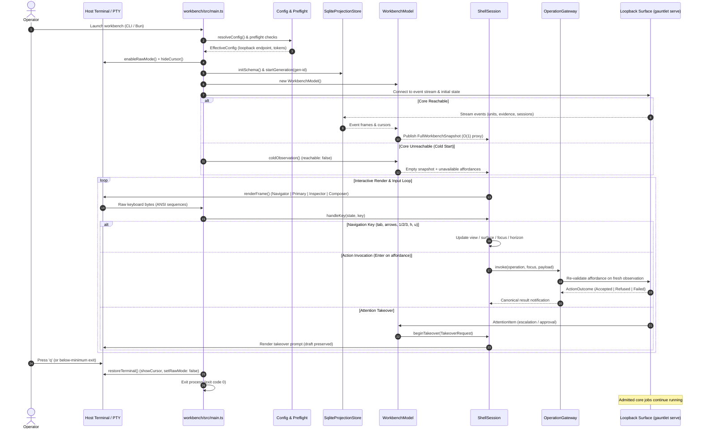

# Workflow: Operator TUI Session Lifecycle

This document traces the complete execution lifecycle of an interactive Gauntlet Operator Workbench session, from process launch and terminal mode negotiation through real-time state projection, affordance dispatch, and clean terminal shutdown.

---

## 1. Summary

The TUI session lifecycle connects an operator terminal to a running or historical Gauntlet execution instance. The workbench boots cold, connects to the loopback HTTP/JSON surface (`gauntlet serve`), rebuilds local read-model projections in a private SQLite store, and enters a nonblocking event loop. Operators navigate cases, units, and evidence, hoist context horizons, adjudicate attention items, and execute authorized operations through an isomorphic gateway. When the operator exits, terminal modes are cleanly restored while underlying Gauntlet core processes continue undisturbed.

---

## 2. Sequence of Execution

---

## 3. Step-by-Step Phase Breakdown

### Phase 1: Preflight & Configuration Resolution

Before launching the interface, the workbench resolves its operating configuration ([`config.ts`](../../workbench/src/config.ts)):
1. **Document Integrity Verification**: When launched via `just tui-preflight bootstrap`, the script validates that `package.json` dependencies are pinned to exact versions, `bun.lock` is synchronized, and `.agents/specs/gauntlet-tui-prime-workbench.spec.yaml` and `DESIGN.md` match their hash-pinned digests in the active plan.
2. **Environment Classification**: Reads `GAUNTLET_ENDPOINT`, `GAUNTLET_SESSION_TOKEN`, and `GAUNTLET_ACTOR` to configure the transport client.
3. **Transport Logging**: Emits transport classification (`local loopback` vs `remote`) strictly to `stderr`, guaranteeing that diagnostic logs never corrupt standard terminal output or render into canonical surfaces (`REQ-CONFIG-005`).

### Phase 2: Host Terminal Mode Initialization

The host runner acquires terminal control ([`main.ts`](../../workbench/src/main.ts)):
1. **Raw Mode Acquisition**: Calls `process.stdin.setRawMode(true)` so keypresses are transmitted byte-by-byte without waiting for newline buffering.
2. **Cursor Suppression**: Emits `\x1b[?25l` to hide the terminal cursor during full-frame repaints.
3. **Geometry Probe**: Reads `process.stdout.columns` and `process.stdout.rows`, defaulting safely to $80\times 24$ if non-TTY.
4. **Clean Exit Trap**: Installs signal handlers (`SIGINT`, `SIGTERM`, `exit`) to ensure `restoreTerminal()` runs even during uncaught exceptions.

### Phase 3: Cold Start & Loopback Surface Handshake

The workbench enforces cold-start honesty (`REQ-UX-001`):
1. **Honest Cold State**: If the loopback surface is not yet connected, the workbench does not synthesize fake connections or pretend tasks are running. It renders a `coldObservation` where `reachable: false`.
2. **Affordance State**: Affordances render with informative reason codes (e.g. `unavailable: endpoint not yet observed`) and provide the exact next step required to connect (`gauntlet serve`).
3. **Surface Connection**: As soon as `client.ts` connects to `gauntlet serve`, it exchanges bearer tokens and starts a new projection generation in SQLite.

### Phase 4: Projection Store Synchronization & Snapshot Publication

State builds incrementally from event streams:
1. **Generation Lifecycle**: `SqliteProjectionStore.startGeneration(genId)` creates a new generation record in WAL mode.
2. **Event Frame Ingestion**: Ingests authoritative events (`unit_updated`, `evidence_added`, `session_updated`, `focus_changed`). Each event atomically updates its source cursor and read-model row within a single SQLite transaction (`REQ-DATA-004`).
3. **Stale Frame Defense**: Frames bearing older or superseded generation IDs are immediately rejected, preventing replay corruption.
4. **Snapshot Fan-Out**: `WorkbenchModel` publishes a `FullWorkbenchSnapshot`. Arrays are wrapped in $O(1)$ proxy views bounded to publication-time length, preventing memory bloat and guaranteeing immutability.

### Phase 5: The Interactive Loop: Focus, Views, and Hoist

The operator interacts with the semantic shell:
1. **Surface Navigation**:
   - `Tab`: Cycles focus across `Navigator`, `Primary`, `Inspector`, and `Composer`.
   - `1`, `2`, `3`: Switches the Primary view between `Work`, `Chat`, and `Trace`.
2. **Entity Selection**:
   - In `Navigator`, `Up`/`Down` navigates the hierarchy of Case $\rightarrow$ Reference $\rightarrow$ Units $\rightarrow$ Runs $\rightarrow$ Evidence.
   - `Enter` selects the highlighted item, updating `snapshot.focus` with an interned `FocusRef`.
   - The `Inspector` immediately renders adjacent relations, evidence records, and available affordances for that entity.
3. **Context Hoisting**:
   - Pressing `h` hoists the selected Focus (e.g. Unit `T23`) into the active `Horizon`. The breadcrumb line updates (`Case › Run 17 › Unit T23`), and subsequent views filter their contents to only objects relevant to `T23`.
   - Pressing `u` (unhoist) pops the active Horizon back to the parent level without destroying domain state.

### Phase 6: Consequential Action Invocation & Admission

When an operator triggers an action (e.g. resolving an escalation or triggering a re-verification):
1. **Affordance Validation**: The affordance resolver confirms that the action is spendable under the active Horizon and Focus.
2. **Idempotency Key Binding**: `OperationGateway` generates a deterministic idempotency key derived from actor, session, unit ID, and payload hash (`REQ-OPS-002`).
3. **Pre-Admission Revalidation**: The gateway queries a fresh canonical observation from Gauntlet core over the loopback surface. If the unit's status changed or authority was revoked, the gateway fails closed without sending the command (`REQ-AFF-003`).
4. **Execution & Settlement**: The command POSTs to `/action`. The Rust core's `SettlementService` executes the transition, commits to the event log, and returns an `ActionOutcome`.
5. **UI Notification**: The workbench displays the canonical outcome (`Accepted`, `Refused`, or `Failed`) with its refusal code preserved.

### Phase 7: Attention Handling & Composer Takeover

When asynchronous processes require immediate human judgment:
1. **Attention Arrival**: Core issues an `AttentionItem` (e.g. human approval required for an `irreversible` Unit).
2. **Takeover Activation**: `composer.beginTakeover()` temporarily suspends the current composition mode and displays the takeover prompt, preserving the operator's unsubmitted text draft in memory (`REQ-TUI-004`).
3. **Resolution / Dismissal**: The operator reviews the request and submits a decision. Upon submission (or dismissal via `Esc`), the takeover closes and the composer restores the prior draft and destination mode.

### Phase 8: Detached Operation & Resumption

The workbench is an observer and command router, not an execution container:
1. **TUI Termination**: If the operator closes the terminal or presses `q`, the workbench process shuts down cleanly.
2. **Core Independence**: Ongoing background agent runs, test executions, and verifications running inside `gauntlet-cli` continue unimpeded.
3. **Reconnection**: Relaunching the TUI opens a new projection generation, syncs cursors with the active event log, and restores the live state.

### Phase 9: Graceful & Abnormal Shutdown

1. **Clean Exit (`q`)**: Restores cursor visibility (`\x1b[?25h`), disables raw mode, and exits with code 0.
2. **Below-Minimum Geometry**: If the terminal is resized below $80\times 24$, the TUI displays a recoverable prompt with an immediate `q` exit path that leaves terminal modes intact.
3. **Abnormal Crash Recovery**: If a panic occurs, the operator can restore their terminal by running `reset` or `stty sane`.

---

## 4. Invariants Enforced Across the Lifecycle

| Invariant ID | Rule Enforced | Implementation Checkpoint |
|---|---|---|
| **REQ-TUI-001** | The TUI never makes authoritative decisions. | Views only project snapshots; mutations go through `OperationGateway`. |
| **REQ-DATA-005** | Chat is non-canonical for Trace. | Disabling Chat projection does not alter a single event in Trace history. |
| **REQ-OPS-002** | Every action carries a deterministic idempotency key. | `OperationGateway.drive()` binds key before transmission; duplicate keys with altered payloads are rejected. |
| **REQ-UX-005** | Strict geometry floors are respected. | Below $80\times 24$, normal rendering halts and a recoverable prompt is shown. |
| **REQ-TUI-004** | Composer takeovers never discard operator drafts. | `composer.beginTakeover()` stores draft in `HeldComposerState` and restores on exit. |

---

## 5. Source Trail

- [`workbench/src/main.ts`](../../workbench/src/main.ts) — Host loop, TTY mode toggles, frame rendering.
- [`workbench/src/shell.ts`](../../workbench/src/shell.ts) — Key handling, view switching, surface focus, horizon hoisting.
- [`workbench/src/operation-gateway.ts`](../../workbench/src/operation-gateway.ts) — Action dispatch, idempotency keys, pre-admission validation.
- [`workbench/src/projection-store.ts`](../../workbench/src/projection-store.ts) — SQLite generation lifecycle and atomic cursor transactions.
- [`workbench/src/composer.ts`](../../workbench/src/composer.ts) — Composer mode states, temporary takeovers, draft preservation.
- [`workbench/src/client.ts`](../../workbench/src/client.ts) — HTTP loopback surface client and event stream consumer.
